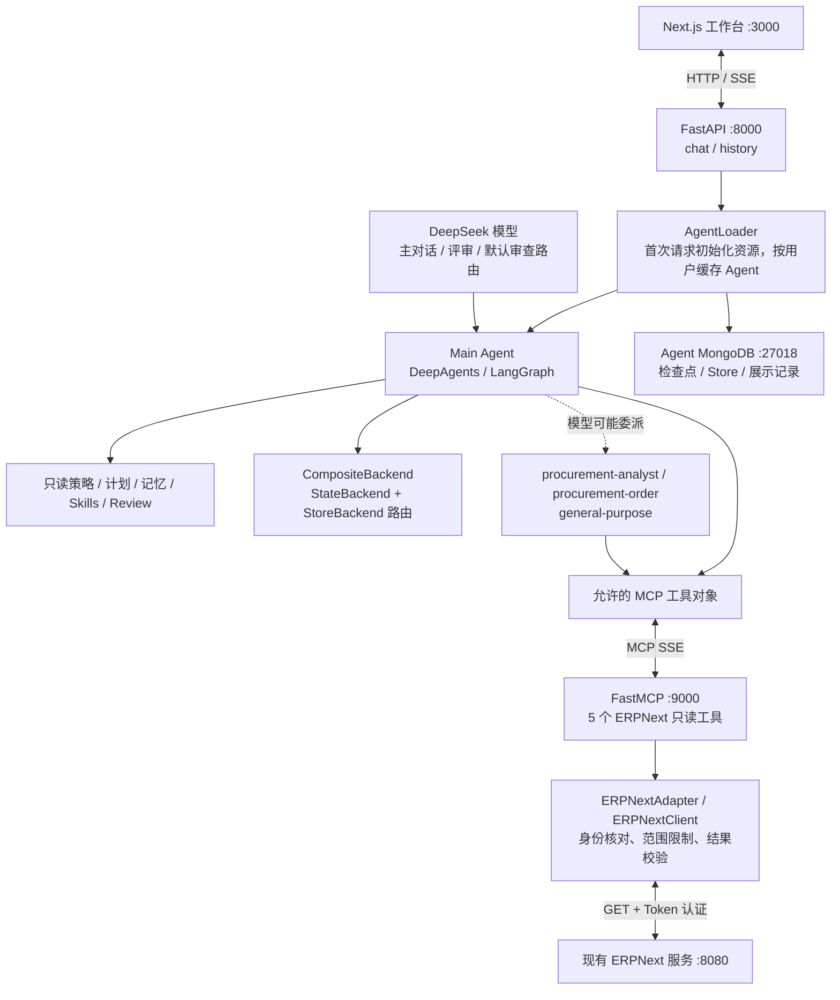

# 供应链协同 Agent｜ERPNext 采购只读助手

> 当前阶段：ERPNext 阶段一，只读查询与采购调查。README 按当前本地源码整理于 2026-11-08；历史实测结果另列日期与范围，本次文档更新没有重新运行验收。

本项目通过自然语言查询 ERPNext 中的供应商、物料、仓库、库存和采购订单表头，并由 Agent 整理证据、生成表格和文字分析。目标场景是智能照明及小家电企业的采购协同；现有真实验收使用服饰演示公司数据，尚不代表目标企业正式业务验收。

技术主线是 **Next.js 前端 → FastAPI → DeepAgents / LangGraph → MCP 工具服务 → ERPNext API**。项目保留规划、子 Agent 委派、独立结果审查、跨会话记忆和 SSE（服务端事件流）展示。

**当前不执行 ERP 业务写入，也不开放命令执行、联网搜索、图表生成或技能安装。Web API 尚无生产登录鉴权；聊天 `user_id` 只用于本地会话区分，所有会话共享一个固定 ERP API 用户。** 当前启动脚本用于本机开发访问。历史订单审批与 Docker 沙箱代码的存在，不代表这些能力已在当前入口启用。

## 阅读入口

| 你想了解什么 | 从哪里开始 |
| --- | --- |
| 项目目前做什么、如何运行 | 本 README |
| 组件如何组装、沿哪条库存链读源码 | [业务能力与源码证据地图](docs/reverse-engineering/01-业务能力与源码证据地图.md)，含函数与行号；定位以 2026-11-05 工作区为基线 |
| 本机安装、配置、启动与停止 | [本地启动说明](docs/START_PHASE1.md) |
| 哪些结果经过真实验证、还有哪些限制 | [阶段一验收记录](docs/PHASE1_ACCEPTANCE.md) |
| 迁移过程、原项目历史和来源 | [迁移记录](docs/PHASE1.md)、[旧 README 快照](docs/archive/README-2026-11-08.md)、[来源声明](THIRD_PARTY_NOTICES.md) |

## 1. 当前能力与业务边界

### 1.1 五类 ERPNext 只读工具

所有工具输入都包在 `query` 对象内，支持 `name` 精确筛选、`limit`（默认 20，范围 1～100）和 `offset`（从 0 开始）。注册位置为 [register_erpnext_tools](src/mcp_server/tools/erpnext_tools.py)，字段契约见 [models.py](src/mcp_server/erpnext/models.py)。

| 业务能力 | 工具名 | 当前返回内容与额外筛选 |
| --- | --- | --- |
| 供应商查询 | `erpnext_suppliers` | 名称、分组、类型、停用标记；未提供信用评级、报价和交期 |
| 物料查询 | `erpnext_items` | `item_code`、名称、分组、库存单位等；此工具没有独立 `item_code` 筛选参数，可按文档 `name` 精确查 |
| 仓库查询 | `erpnext_warehouses` | 白名单内仓库的名称、公司、分组和停用标记 |
| 库存查询 | `erpnext_bins` | 支持 `item_code/warehouse` 筛选；返回现存量、预留量、已订购量、预计量等 |
| 采购订单查询 | `erpnext_purchase_orders` | 支持 `supplier/status/docstatus` 筛选；只返回表头，包括日期、币种、总额、收货/开票百分比 |

理解查询结果时，需要保留这些边界：

- Supplier / Item 是共享主数据，范围由固定 Frappe API 用户的权限决定；没有在这两类查询上添加公司过滤。
- Warehouse / Bin 受服务端公司和仓库白名单限制；Bin 查询先核对仓库所属公司。采购订单按公司与 Frappe 权限过滤，**没有读取或校验订单行仓库**。
- `actual_qty` 是现存实物数量；`projected_qty` 含计划因素，不等于可用实物库存。当前未提供需求历史、安全库存阈值、交期等完整补货依据，不能据此宣称已实现可靠的定量补货算法。
- `status` 是 ERPNext 业务状态字符串；`docstatus` 是 0 草稿、1 已提交、2 已取消，两者用途不同。
- 返回值包含 `data/limit/offset/has_more/scope`。模型需要继续调用才能翻页；单页不代表全量，空结果也不能替代权限与查询条件检查。

范围约束由 [ERPNextAdapter.query](src/mcp_server/erpnext/adapter.py) 执行，HTTP 读取与身份核对由 [ERPNextClient](src/mcp_server/erpnext/client.py) 执行。公司、仓库和凭据来自服务端配置，不由模型选择。

### 1.2 Agent 已接入的交互能力

| 能力 | 当前实现 |
| --- | --- |
| 规划与委派 | `write_todos` 维护待办；Main Agent 可直接使用工具，也可通过 `task` 委派子 Agent。是否委派由模型动态决定 |
| 采购分析 | 基于实际读取的数据输出文字和 Markdown 表格；分析质量取决于数据范围和模型表现，不等同于专用预测算法 |
| Review（结果审查） | 规则和可选路由模型决定是否审查；Grader（评审器）对照标准检查执行结果，可有限修订 |
| 会话与记忆 | 检查点保存当前线程状态；Store 保存用户长期记忆/技能；展示消息、会话列表和阶段记录另存 MongoDB |
| Skills（技能文本） | 通过 `list_skills/read_skill/read_skill_resource` 按需读取；基础目录是 `src/skills/erpnext`，也可读取用户 Store 中已有技能；读取不授予额外工具权限 |
| 流式展示与追踪 | 展示回答、工具、待办、阶段和评审事件；可选 Langfuse 元数据追踪，默认关闭 |

“只读”针对 ERP 业务数据：聊天记录、计划、虚拟文件和长期记忆仍会写入 Agent 自己的状态或数据库。

### 1.3 保留但未启用的能力

旧 Java ERP 工具、出入库/订单写入、图表与文档生成、联网搜索、Skill 安装、Docker 执行沙箱仍有历史代码，但没有接入当前业务工具清单。主/子 Agent 均受 [ReadOnlyToolPolicy](src/agent/tool_policy.py) 允许名单和执行时检查约束，旧 [ERPHttpClient](src/mcp_server/http_base.py) 的业务请求也被拒绝。

HITL（人工介入）的中断展示与恢复接口仍保留，但当前 [INTERRUPT_ON_TOOLS](src/agent/config.py) 为空；正常只读调查没有订单写入审批，批准也不会解除写入限制。API 的文件下载路由仍存在，它不代表 Agent 已拥有文件生成或沙箱下载工具。

## 2. 当前架构与组件生命周期

### 2.1 系统关系



端口为当前本地配置示例。FastAPI 与 MCP 是两个独立服务；图中的数据库表示共同存储位置，各组件并非共用一个连接对象。

### 2.2 谁创建、谁持有、传给谁

| 组件 | 创建与传递关系 | 时机 |
| --- | --- | --- |
| FastAPI App | [web_main.py](src/api_view/web_main.py) 创建 `app` 并注册 Chat / History 路由 | 模块加载；启动时不预建用户 Agent、不预热沙箱 |
| AgentLoader / AgentSession | [get_session](src/api_view/agent_loader.py) 按 `user_id` 缓存 `AgentSession`，其中持有图和运行锁；`thread_id` 区分对话检查点 | Loader 为单例；首次请求某用户时创建其 Agent，后续复用 |
| Checkpointer / Store | Loader 从 [config.py](src/agent/config.py) 读取 MongoDB 配置，创建 `MongoDBSaver/MongoDBStore`，经 `_build_agent_for_user` 传入 `create_main_agent`，再交给图 | 首次共享资源初始化；跨用户共享存储组件，按线程或命名空间区分记录 |
| Main Agent / Model | [create_main_agent](src/agent/main_agent.py) 组装主模型、评审模型、工具、子 Agent、Backend 和中间件；返回可执行图，交给 Session 持有 | 每个用户 Agent 创建时；不是每条消息重新创建 |
| SubAgents（子智能体） | [loader.py](src/agent/subagents/loader.py) 解析 YAML 为角色、工具和输出要求，交给主图；另显式加入通用只读子 Agent | 组装时配置；运行时是否委派由模型决定 |
| Middleware / Backend | 中间件包裹执行；`CompositeBackend` 默认使用 `StateBackend` 虚拟文件，`/memories/` 和 `/persisted-skills/` 路由到 `StoreBackend` | 随用户 Agent 创建；当前没有 Docker 或宿主机命令执行后端 |
| MCP Client / Server | [load_mcp_tools](src/agent/tools/mcp_client.py) 发现工具，筛选后交给主/子 Agent；[server_main.py](src/mcp_server/server_main.py) 在独立进程注册工具 | Agent 组装时发现工具，成功工具列表缓存 300 秒；Server 启动时注册 |
| ERPNext Client / Adapter | 每次 MCP 工具执行时创建 Client 与 Adapter；Client 核对固定 API 用户，Adapter 追加范围过滤并验证返回值 | 每次工具调用创建并关闭，不是旧 Java ERP 客户端单例 |

两个配置传递链尤其重要：

- **Agent 存储**：`.env → config.py → AgentLoader → Checkpointer / Store → 主图与记忆组件`。
- **ERP 查询权限**：`.env → ERPNextSettings.from_env → ERPNextClient / Adapter → ERPNext API`。聊天 `user_id` 不会沿此链变成 ERP 登录用户。

主 Agent 默认显式加载 5 个 ERP 工具（连接成功时）、2 个可关闭的记忆工具、3 个技能读取工具；框架工具另受允许名单约束，不再沿用“23 个 MCP / 35 个总工具”的旧统计。[分析子 Agent](src/agent/subagents/configs/procurement_analyst.yaml) 与 [采购子 Agent](src/agent/subagents/configs/procurement_order.yaml) 都配置了这 5 个查询工具，区别主要是角色与输出要求，而非不同 ERP 权限。

### 2.3 规划、审查与记忆如何配合

规划与执行由主图推进，审查是按需启用的。配置见 [harness_config.yaml](src/agent/harness_config.yaml)：默认 `review.mode=auto`、`strategy=hybrid`；明确请求先走规则，模糊请求才调用审查路由模型。该路由只判断“是否需要 Review”，不负责选择采购子 Agent。可通过 `REVIEW_ROUTER_PROVIDER=jev` 切换可选路由模型，不替换主对话与 Grader。

执行后的工具错误、多次调用、委派等信号可升级审查；一般只读任务的评审上限默认 3 轮，发生子任务委派后采用单轮评审以避免整轮自动重放。旧 `order/supplier` 评审模板仍包含 Java ERP 字段或当前未返回的数据，属于已知待完善项，不能作为能力已实现的证据。入口见 [HarnessPhaseMiddleware](src/agent/harness.py)、[ReviewPolicy](src/agent/review_policy.py)、[ReviewExecutionGate / SafeRubricMiddleware](src/agent/middlewares/review_gate.py)。

| 记忆层 | 用途 | 当前实现 |
| --- | --- | --- |
| HOT（当前会话） | 延续本线程的消息、工具结果和待办 | 图状态与 Checkpointer；不是独立数据库 |
| WARM（近期记忆） | 每次主模型调用前刷新偏好与近期摘要 | `WarmMemoryMiddleware` 从 Store 读取，注入文本最多 4000 字符 |
| COLD（长期历史） | 按需查找过去的摘要与经验 | `read_memory` 调用 `MemoryKeeper` 检索；`remember` 显式写入长期记忆 |

偏好提取默认使用规则，情节归档和过期清理由运行结束钩子触发。`MEMORY_TOOLS_ENABLED=false` 只关闭两个显式记忆工具，不等于关闭全部记忆中间件。主 Agent 使用动态记忆注入；两个业务子 Agent 的 YAML 没有直接配置 `read_memory/remember`。见 [memory 配置](src/agent/memory/config.py)、[记忆工具](src/agent/tools/memory_tools.py)。

## 3. 本地安装与启动

### 3.1 环境与依赖

已有本项目 `.venv` 和前端依赖时，可跳到配置及启动。首次安装采用锁文件；当前记录的验证环境是 macOS ARM64、Python 3.12.14，前端项目声明 Node `>=24.22.1 <25`、pnpm `11.25.0`。还需要 Docker Compose 启动独立 Agent MongoDB，以及已部署、可访问的 ERPNext 服务。

在项目根目录执行：

```bash
python3.12 -m venv .venv
.venv/bin/python -m pip install -r requirements.lock.txt
source scripts/runtime-env.sh
(cd frontend && pnpm install --frozen-lockfile --store-dir ../.pnpm-store)
```

`requirements.txt` 固定直接依赖，`requirements.lock.txt` 还包含传递依赖、测试与 Langfuse 依赖；前端以 `pnpm-lock.yaml` 安装。其他平台尚需单独核对锁文件兼容性。启动脚本优先使用正常安装的 Node/pnpm，找不到时尝试本机已有的随附运行环境，不会自动下载它们；详见 [本地环境说明](docs/START_PHASE1.md)。

### 3.2 配置 `.env`

仅在尚未创建 `.env` 时，从模板复制；已有配置不要覆盖：

```bash
if [ ! -e .env ]; then
  cp .env.example .env
fi
```

按 [.env.example](.env.example) 填写以下配置，密钥留在本地配置文件中：

| 配置 | 作用 / 示例 |
| --- | --- |
| `DEEPSEEK_API_KEY`、`LLM_MODEL`、`LLM_BASE_URL` | 主对话与评审模型；模板模型为 `deepseek-flash`，以账户实际可用模型为准 |
| `MONGODB_URI`、`MONGODB_DB_NAME` | 模板为 `mongodb://127.0.0.1:27018`、`supply_chain_agent`，供 Agent 历史、检查点和 Store 使用 |
| `ERPNEXT_BASE_URL` | ERPNext 地址；本地示例 `http://127.0.0.1:8080` |
| `ERPNEXT_API_KEY`、`ERPNEXT_API_SECRET` | 专用只读用户的 API 凭据，不使用 Administrator |
| `ERPNEXT_API_USER` | 预期 API 用户；客户端调用 `get_logged_user` 核对实际身份 |
| `ERPNEXT_COMPANY`、`ERPNEXT_WAREHOUSES` | 公司全名与允许的完整 `Warehouse.name`；多个仓库用逗号分隔 |
| `MCP_SERVER_URL` | API 进程连接的 MCP 地址，模板为 `http://127.0.0.1:9000` |
| `MCP_HOST`、`MCP_PORT` | MCP 监听地址，模板为 `127.0.0.1`、`9000` |
| `ERP_LANGFUSE_ENABLED` | 可选，默认 `false`；启用时还需 `LANGFUSE_BASE_URL`、`LANGFUSE_PUBLIC_KEY`、`LANGFUSE_SECRET_KEY`、`ERP_TRACE_HASH_KEY` |

当前 ERPNext Client 不读取旧 `ERP_BASE_URL`；模板中保留的联网搜索变量也不会启用已禁用的工具。修改配置后重启 API 与 MCP。专用账户准备及权限说明见 [配置说明](docs/CONFIGURE_READONLY_AND_LANGFUSE.md)；Langfuse 行为见 [可观测性说明](docs/LANGFUSE.md)，只上报执行元数据，不上传对话/工具业务正文。

### 3.3 启动服务

本工程只启动 Agent 自己的 MongoDB，**不部署或重建 ERPNext**。先确认现有 ERPNext 服务可用，在项目根目录执行：

```bash
docker compose up -d mongo
```

再分别打开三个终端，每个终端进入项目根目录后执行一条：

```bash
./scripts/start.sh mcp
```

```bash
./scripts/start.sh api
```

```bash
./scripts/start.sh web
```

建议先启动 MCP，再发送第一条聊天请求。API 启动本身不会预建 Agent；若首次构建用户 Agent 时 MCP 不可用，会得到不含 ERP 工具的图，并被用户 Session 缓存。修复 MCP 后重启 API 再试，不能只等待工具发现缓存过期。当前无需手动启动 `erp-sandbox`。

| 服务 | 本地地址与用途 |
| --- | --- |
| 工作台 | [http://127.0.0.1:3000/](http://127.0.0.1:3000/) |
| FastAPI 接口文档 | [http://127.0.0.1:8000/docs](http://127.0.0.1:8000/docs) |
| API 存活检查 | [http://127.0.0.1:8000/health](http://127.0.0.1:8000/health)，只表示进程能响应，不验证模型、MongoDB 或 ERP |
| MCP SSE | [http://127.0.0.1:9000/sse](http://127.0.0.1:9000/sse)，工具协议长连接，不是普通业务网页 |
| Agent MongoDB | `127.0.0.1:27018`，由本工程 Compose 管理，与 ERP 数据库分开 |

可先在工作台输入：“查询当前允许范围内的前 5 条库存记录，用表格展示物料、仓库、现存量和预计量，并说明是否还有下一页。”这只是首个查询示例，不是自动通过的验收用例。

停止前端、API、MCP 时在各终端按 Ctrl+C；停止本工程 MongoDB 并保留数据卷：

```bash
docker compose stop mongo
```

## 4. 从一条库存查询开始读代码

建议先理解这条链的输入、权限和结果，再展开记忆、Review 等支路：

1. **前端请求**：[useChat.doSend](frontend/src/hooks/useChat.ts) 组装自然语言消息和会话信息，[streamChat](frontend/src/lib/api.ts) 发 `POST /api/chat/stream`。
2. **接口与 Schema（数据结构约束）**：[ChatRequest](src/agent/schema.py) 校验入参，[chat_stream](src/api_view/api/chat.py) 准备会话并返回 SSE；聊天请求本身没有结构化物料/仓库字段。
3. **Agent 运行**：`stream_chat_response` 获取 [AgentLoader.get_session](src/api_view/agent_loader.py)，调用 `session.agent.astream`。主模型可能直接选 `erpnext_bins`，也可能先委派子 Agent，或补问查询条件。
4. **工具与 ERP**：[erpnext_bins](src/mcp_server/tools/erpnext_tools.py) 接收 `BinQuery`；Client 核对身份，Adapter 验证仓库归属并加过滤，之后读取 `/api/resource/Bin`，校验字段和范围，返回 `ReadResult`。
5. **结果与展示**：工具结果交回图，模型可继续查询或汇总，按策略接受审查；`stream_chat_response` 把消息/状态转为 SSE，[SSEParser.parse](frontend/src/lib/sse-parser.ts) 与 [useChat.handleEvent](frontend/src/hooks/useChat.ts) 更新页面。

这是一条源码可达路径，**不是每次请求必然执行的轨迹**。一次成功的 `erpnext_bins` 工具调用会先后 GET 身份、Warehouse、Bin；整轮对话还可能翻页或调用其他工具。各节点起始行、输入输出及动态分支见 [源码证据地图第 03 部分](docs/reverse-engineering/01-业务能力与源码证据地图.md)。

## 5. API 与 SSE 事件

接口定义以 [chat.py](src/api_view/api/chat.py)、[history.py](src/api_view/api/history.py)、[web_main.py](src/api_view/web_main.py) 为准。

| 方法 | 路径 | 用途与限制 |
| --- | --- | --- |
| POST | `/api/chat/stream` | 新消息流式对话；入参 `message`，可带 `thread_id/user_id/username` |
| POST | `/api/chat/{thread_id}/resume` | 恢复已有中断；入参 `resume_data`，无待恢复中断时拒绝；保留机制，不代表已启用采购写入 |
| GET | `/api/chat/{thread_id}/state` | 查询中断状态 |
| GET | `/api/chat/{thread_id}/history` | 查询展示消息 |
| GET | `/api/history?user_id=...` | 查询用户的会话列表；`user_id` 是查询参数 |
| GET | `/api/history/{thread_id}/messages` | 查询指定会话展示消息 |
| DELETE | `/api/history/{thread_id}` | 删除会话、展示消息和阶段记录；不同时删除图检查点或长期记忆 |
| GET | `/api/download/{filename}` | 返回下载目录内已有文件；当前没有对应的 Agent 文件生成工具 |
| GET | `/health` | API 进程存活检查 |

SSE 数据按 `event: 事件名` 与 `data: JSON` 传输。事件可多次出现、交错到达；以下是事件类型表，不是固定执行顺序：

| 事件 | 含义 |
| --- | --- |
| `thinking` | 开始或结束等待模型内容的提示 |
| `token` | 模型文本片段 |
| `tool_start` / `tool_args` | 工具调用开始与参数片段 |
| `tool_result` / `tool_end` | 工具结果与调用结束 |
| `phase` / `todo_update` | 执行阶段、待办状态更新 |
| `review_result` | 评审结论、依据与迭代次数 |
| `interrupt` | 检查点中断，需要相应恢复输入 |
| `error` | 流处理捕获到执行异常时发送的错误事件 |
| `done` | 本次流结束，附 `thread_id/interrupted`；异常路径可带 `failed=true` |

`done`、`phase=result` 都不单独证明业务成功；需结合工具证据、数据范围、评审结果和失败/中断标记判断。SSE 工具结果展示截到 2000 字符，保存的工具展示结果截到 1000 字符，不应当作完整原始数据。请求校验、缺模型 Key 等流开始前错误走 HTTP 响应，不是所有失败都表现为 SSE `error`。

## 6. 开发导航与验证

### 6.1 源码导航

| 目录 / 文件 | 阅读目的 |
| --- | --- |
| [frontend/src](frontend/src) | 输入、对话状态、SSE 消费、历史与中断 UI |
| [src/api_view](src/api_view) | FastAPI、用户 Agent 缓存、展示记录存储 |
| [src/agent/main_agent.py](src/agent/main_agent.py) | 模型、工具、子 Agent、中间件与 Backend 的唯一主组装入口 |
| [src/agent/subagents/configs](src/agent/subagents/configs) | 两个业务子 Agent 的角色、工具和输出要求 |
| [src/agent/tool_policy.py](src/agent/tool_policy.py) | 主/子 Agent 的允许名单与运行时阻断 |
| [src/agent/harness.py](src/agent/harness.py)、[middlewares](src/agent/middlewares) | 阶段状态、上下文、记忆和评审钩子；沙箱相关类保留，但当前沙箱后端未启用 |
| [src/agent/memory](src/agent/memory) | 跨会话记忆的提取、检索、合并与清理 |
| [src/agent/progressive_skills.py](src/agent/progressive_skills.py)、[src/skills/erpnext](src/skills/erpnext) | 当前技能目录及按需读取 |
| [src/mcp_server/erpnext](src/mcp_server/erpnext)、[erpnext_tools.py](src/mcp_server/tools/erpnext_tools.py) | ERP 字段、认证、范围限制、HTTP 查询与工具注册 |
| [tests](tests)、[scripts/check.sh](scripts/check.sh) | 当前阶段测试和统一检查入口 |

新增只读 ERP 工具时，依赖链是 **Schema/Adapter → MCP 注册 → Agent 允许名单 → 需要该能力的子 Agent YAML → 测试**。只在目录里添加一个工具文件不会生效。技能正文或提示词也不能绕过允许名单。未来 ERP 写入需要独立的业务契约、权限、审批、幂等与失败恢复设计，不能直接重新注册旧 Java ERP 写工具。

### 6.2 检查命令

在项目根目录运行统一检查：

```bash
./scripts/check.sh
```

它执行 Python 依赖检查、阶段一单元/模拟测试与选定历史回归，以及前端测试和生产构建；默认不启用真实 ERP、Mongo 集成或真实模型调用。两个真实集成开关在环境中显式开启时，相应测试会运行。集成检查可单独执行：

```bash
# 专用只读凭据齐备后：真实 ERPNext GET 查询
RUN_ERPNEXT_INTEGRATION=1 .venv/bin/python -m pytest tests/test_live_erpnext.py -q

# 独立 Agent MongoDB：创建并清理随机临时测试库，不访问 ERP 数据库
RUN_AGENT_MONGO_TEST=1 .venv/bin/python -m pytest tests/test_mongo_persistence.py -q
```

不要将旧 Java ERP 的 `src/test/test_all_tools.py` 或旧业务评测脚本当作当前验收入口。测试分类见 [pytest.ini](pytest.ini)；更完整的复跑方式见 [验收记录](docs/PHASE1_ACCEPTANCE.md)。

### 6.3 已有证据与已知限制

[2026-10-30 验收记录](docs/PHASE1_ACCEPTANCE.md) 记载：本机现有演示数据范围内，真实工作台 → FastAPI → 主/子 Agent → MCP → ERPNext 只读查询、Review、历史展示和 Langfuse 轨迹核对通过。后续 MongoDB 配置统一另有回归记录；不同轮次没有合并成一次验收。

这些记录不证明目标企业数据、全量分页、所有跨公司/仓库权限组合、并发性能或持续稳定性已经验收。当前仍需关注：

- 真实采购写入、库存调整、提交/取消、订单行适配和生产登录鉴权尚未开放。
- 部分评审模板仍含旧字段；独立 Review 也不能替代确定性业务规则和数据核对。
- 历史实测出现过模型流式超时和较高 Token 用量；一次成功不代表稳定性保证。
- 验收记录包含尚未处理的依赖安全审计事项；详情与适用范围见原记录，本文不把历史审计数字作为当前实时扫描结果。

本次 README 更新仅做源码与文档核对，没有重新运行上述业务或集成测试。

## 7. 故障定位与历史资料

| 现象 | 优先检查 |
| --- | --- |
| 页面可打开，但聊天提示模型未配置 | `.env` 中 `DEEPSEEK_API_KEY`，修改后重启 API；`/health` 不检查模型 |
| 有普通回答，但没有 ERP 查询工具 | MCP 是否可连接；检查工具发现日志。首次用户图已在无工具状态下创建时，修复 MCP 后重启 API |
| 工具返回 `configuration_required` / `identity_mismatch` | ERPNext 凭据、预期 API 用户、公司和仓库白名单；不要以空结果处理认证问题 |
| `warehouse_denied` / `warehouse_company_mismatch` | 请求仓库完整名称是否在白名单、是否属于配置公司，以及固定 API 用户是否可读取它 |
| MongoDB 连接失败或历史为空 | `.env` 的 URI/数据库名称是否与本工程 Compose 一致；本地模板端口是 27018 |
| 前端安装/启动失败 | 使用项目声明的 Node/pnpm 与冻结锁文件；移动目录后参照本地启动说明重建依赖 |

历史资料保留用于理解演进，描述中的工具、沙箱和测试结果需结合所属版本阅读：

- [更新前 README 完整快照](docs/archive/README-2026-11-08.md)：旧功能、启动方式与历史更新，不再作为当前运行指南。
- [变更记录](docs/CHANGES.md)、[ERPNext 迁移记录](docs/PHASE1.md)：迁移过程；最新验收范围以 `PHASE1_ACCEPTANCE.md` 为准。
- [Skills 渐进披露](docs/PROGRESSIVE_SKILLS.md)、[Langfuse 说明](docs/LANGFUSE.md)：机制说明；涉及安装/沙箱等历史能力时，以本文当前入口为准。
- [历史 Java ERP 能力测试](docs/AGENT_LIVE_TESTS_20261023.md)、[历史模型评测](docs/LANGFUSE_LIVE_EVALUATION_20261023.md)、[审查路由实验](evals/review_routing/FINDINGS.md)：不作为本阶段 ERPNext 能力或成功率的替代证据。
- [原始来源与保留声明](THIRD_PARTY_NOTICES.md)：上游来源、迁移基线与保留说明。
