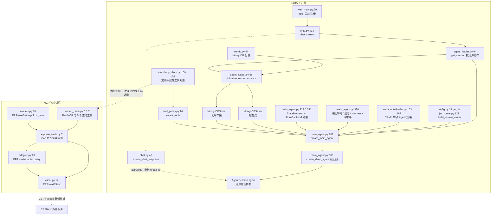

# 供应链协同 Agent｜业务能力与源码证据地图

> 源码事实基线 · 2026-11-05 · 第一阶段
>
> 分析对象：`/Users/zhanggengyu/Documents/供应链协同Agent` 当前工作区；HEAD 为 `d925310`，包含分析前已经存在的未提交修改，因此不是该提交的纯净快照。仅静态阅读本地源码、配置与测试；未启动服务、运行测试、调用模型或访问 ERPNext，未读取凭据。本文不把历史验收记录当成本次执行轨迹。

**当前可确认的是一个 ERPNext 采购只读助手：查询供应商、物料、仓库、库存 Bin、采购订单表头，通过模型选择工具或委派子 Agent，并以流式对话返回。** 依据：[MCP 注册入口][server] 模块级 L6–7、[工具注册][erp-tools] `register_erpnext_tools` L15；[主 Agent 组装][main] `create_main_agent` L188（工具选择 L247、图创建 L389）。订单写入、库存调整和脚本执行未在当前入口开放。

阅读约定：

- **【源码事实】**：有实现、注册关系或测试源码作为证据；不等于真实环境运行成功。
- **【合理推断】**：由实现推测的业务目标或设计动机；不视为已确认需求。
- **【待验证】**：源码不足以证明的行为、效果或运行状态。
- 状态“已实现”指当前入口已接入代码；“部分实现”指仅有部分数据或流程；“仅配置/预留”也包括遗留但未接入当前入口的代码；“无法确认”指不能判定实际效果。
- 文件链接指向本机完整路径，`L数字` 为当前文件中的行号；函数标注其定义起始行，必要时另列关键语句行。配置文件用键名与行号定位，无函数的入口标为“模块级”。Mermaid 图只表达本项目可见关系，不展开第三方框架内部实现。

## 01｜业务能力清单

### 1.1 当前采购业务能力

下表业务能力均为【源码事实】。参与者简称：**Main**＝`procurement-main-agent`；**分析子 Agent**＝`procurement-analyst`；**采购子 Agent**＝`procurement-order`。两个业务子 Agent 都配置了全部 5 个 ERPNext 查询工具，不是按业务权限相互隔离；Main 也持有这些工具。另有 `general-purpose` 通用只读子 Agent。组装证据：[main][main] `create_main_agent` L188，关键 L249、L275–284；[分析配置][analyst] `tools` L3；[采购配置][order-agent] `tools` L3。

| 编号 / 场景与用户目标 | 当前实现与边界 | Agent / Tool（工具） | 真实源码定位 | 状态 |
| --- | --- | --- | --- | --- |
| B1 供应商查询：确认供应商名称、分组、类型、停用标记 | 分页列出或按 `name` 精确筛选；返回 `supplier_name/supplier_group/supplier_type/disabled`。当前查询参数没有供应商名称模糊搜索；返回模型没有信用评级、交期、报价字段 | Main 或任一业务子 Agent → `erpnext_suppliers` | [src/mcp_server/tools/erpnext_tools.py][erp-tools] `erpnext_suppliers` L17；[models.py][erp-models] `Query` L26、`Supplier` L41；[adapter.py][adapter] `ERPNextAdapter.query` L13 | **已实现**：限定字段的只读查询 |
| B2 物料查询：确认物料编码、名称、分组、库存单位 | 分页或按 `name` 精确查；返回字符串 `item_code`、`stock_uom` 等。没有物料价格、供应商关联明细查询；`erpnext_items` 不接受 `item_code` 独立筛选参数 | Main / 子 Agent → `erpnext_items` | [erpnext_tools.py][erp-tools] `erpnext_items` L22；[models.py][erp-models] `Query` L26、`Item` L48 | **已实现**：物料主数据读取 |
| B3 仓库查询：知道允许查询哪些仓库 | 服务端追加固定公司、仓库白名单，返回仓库名称、公司、分组和停用标记；不开放任意公司选择 | Main / 子 Agent → `erpnext_warehouses` | [erpnext_tools.py][erp-tools] `erpnext_warehouses` L27；[adapter.py][adapter] `query` L13（L22–24）；[models.py][erp-models] `Warehouse` L57 | **已实现** |
| B4 库存查询：查看物料在指定仓库的现存、预留、已订购和预计数量 | `BinQuery` 支持 `item_code/warehouse/name/limit/offset`。先验证仓库归属，再查 Bin；输出 `actual_qty/reserved_qty/ordered_qty/projected_qty`。这是库存记录读取，不是实时盘点、库存流水或安全库存预警 | Main / 子 Agent → `erpnext_bins` | [erpnext_tools.py][erp-tools] `erpnext_bins` L32；[models.py][erp-models] `BinQuery` L32、`Bin` L64；[adapter.py][adapter] `query` L13（L25–38） | **已实现**；本次选定的学习主链 |
| B5 采购订单查询：追踪订单状态和金额 | 按 `name/supplier/status/docstatus` 精确筛选并分页；返回公司、供应商、日期、币种、总额、收货/开票百分比。**只有表头**，没有订单行、按物料查订单、订单行仓库校验或订单统计专用接口 | Main / 子 Agent → `erpnext_purchase_orders` | [erpnext_tools.py][erp-tools] `erpnext_purchase_orders` L37；[models.py][erp-models] `PurchaseOrderQuery` L36、`PurchaseOrder` L75；[adapter.py][adapter] `query` L13（L39–46） | **已实现**：表头查询；全量订单管理仅部分覆盖 |
| B6 采购/库存分析：把查询结果整理成表格和结论 | 配置分析角色、数据范围说明、建议等输出要求，工具提供上述数据；分析由 LLM（大语言模型）生成，未见当前入口接入专用库存分析算法。分页需模型继续调用，非工具自动抓取全量 | Main 可委派分析子 Agent，也可直接处理；5 个只读工具 | [procurement_analyst.yaml][analyst] `system_prompt` L9、`output_format` L19；[loader.py][sub-loader] `build_output_contract_prompt` L79、`resolve_subagent_tools` L187；[adapter.py][adapter] `query` L13（L47–60） | **部分实现**：数据读取和分析编排已接入；结论正确性**无法确认** |
| B7 补货建议：判断缺货风险、建议采购量 | 能提供库存上下文，提示词允许文字建议；当前数据模型没有需求历史、供应商交期、安全库存阈值，也没有已接入的补货量计算工具。不能据此宣称支持可靠的自动补货决策 | Main / 分析子 Agent；旧 `inventory-optimizer` Skill 不是当前基础技能目录 | [models.py][erp-models] `Item` L48、`Bin` L64、`PurchaseOrder` L75；[main][main] `SKILLS_DIR` L33、`create_main_agent` L188；[旧 Skill][inventory-skill] “核心功能” L13、“使用方式” L19 | **部分实现**：建议所需的库存查询；定量补货能力**无法确认**，旧优化技能**仅配置/预留** |

**共同查询契约。** [models.py][erp-models] `Query` L26 禁止额外字段，默认 `limit=20`、范围 1–100、`offset≥0`；`ReadResult` L89 返回 `data/limit/offset/has_more/scope`。`ERPNextAdapter.query` L13 多取 1 条判断 `has_more`，不返回总条数。Supplier/Item 只依赖固定 API 用户的 Frappe 权限；Warehouse/Bin 额外限定公司和仓库；采购订单表头限定公司、不按仓库过滤。`disabled/is_group` 是返回字段，适配器没有自动排除这些记录。[adapter.py][adapter] L18–60。

### 1.2 支撑业务交互的能力

| 用户目标 | 当前实现 / Agent 与工具 | 源码证据 | 状态 |
| --- | --- | --- | --- |
| 看见回答、工具过程、计划和评审结果 | Main 图的消息、状态与自定义事件转成 SSE（服务端事件流），前端逐步更新；`write_todos` 维护待办 | [chat.py][chat] `stream_chat_response` L46、`sse_event` L27；[useChat.ts][use-chat] `handleEvent` L57；[main][main] `create_main_agent` L188（L338） | **已实现**；是否实际生成计划由模型行为决定 |
| 对分析结果进行独立审查 | 主图注册 Harness（执行编排）阶段中间件、规则/模型审查路由、Grader（评审器）；可跳过审查，也可依据工具执行信号升级；子任务委派会限制自动重做 | [harness.py][harness] `HarnessPhaseMiddleware.abefore_agent` L287；[review_policy.py][review-policy] `ReviewPolicy.astart` L146；[review_gate.py][review-gate] `execution_signals` L9、`ReviewExecutionGate.after_agent` L51、`SafeRubricMiddleware.aafter_agent` L78 | **已实现**：机制；不等于业务结论必然正确 |
| 延续同一会话、查看历史 | `thread_id` 对应图检查点；会话/展示消息另存 MongoDB，可列出、读取、删除展示记录。删除函数未同时删除检查点和长期记忆 | [agent_loader.py][loader] `create_config` L146、`save_display_messages` L161、`save_conversation` L176、`delete_conversation` L202；[history.py][history] `list_conversations` L13、`get_messages` L20、`delete_conversation` L27 | **已实现**：会话记录管理；不是完整数据清除 |
| 记住输出偏好、检索过去对话摘要 | 主 Agent 默认可用 `read_memory/remember`；模型调用前刷新 WARM（近期记忆），运行后提取偏好与归档摘要；实际需 Store 可用。采购业务子 Agent 的 YAML 未直接配置这两个工具 | [memory_tools.py][memory-tools] `read_memory` L18、`remember` L46；[warm_memory.py][warm] `_refresh` L18；[memory_update.py][memory-update] `after_agent` L44；[memory_consolidation.py][memory-consolidation] `after_agent` L37；[memory/config.py][memory-config] `MemoryConfig` L35（默认开关 L68） | **已实现**：有条件的跨会话记忆；它是本地数据写入，不是 ERP 写入 |
| 按需读取采购操作约定 | 主/子 Agent 共享技能目录与 `list_skills/read_skill/read_skill_resource`，按需加载文本；基础目录为 `src/skills/erpnext`，还可读取当前用户 Store 中已有技能 | [main][main] `create_main_agent` L188（L262–265）；[progressive_skills.py][skills] `SkillCatalog.entries` L111、`tools` L228、`attach_to_subagents` L298；[当前 Skill][erp-skill] L1 | **已实现**：读取；不是技能安装或脚本执行 |
| 人工批准或补充资料后继续 | API、前端中断展示和检查点恢复代码保留；但当前 `INTERRUPT_ON_TOOLS={}`，无 ERP 写工具、无 `request_order_info` 注册 | [chat.py][chat] `validate_resume` L447、`chat_resume` L484；[schema.py][schema] `ResumePayload` L46、`ResumeRequest` L58；[config.py][config] L91；[tool_policy.py][policy] `ALLOWED_TOOLS` L12 | **部分实现**：恢复机制已实现，采购写入审批未开放 |
| 回看执行过程 | 保存本地阶段/评审 trace（轨迹记录）；可选接入 Langfuse，仅发元数据，默认关闭；本轮未验证开启状态 | [loader][loader] `save_harness_trace` L209；[observability.py][observability] `client` L18、`traced_stream` L154、`traced_config` L183 | **已实现**：本地记录；外部追踪按配置启用 |

### 1.3 README 与当前入口的差异

以下不是简单的“README 功能全未开发”：部分是**旧版实现被停用**，部分只有技能描述。当前可达性应以注册和允许名单为准。

| README / 遗留材料中的说法 | 当前源码事实及定位 | 当前判定 |
| --- | --- | --- |
| 创建/修改/审批采购订单；订单专家做 CRUD（增删改查） | [README][readme] L16、L238；旧 [order_tools.py][legacy-order] `order_create` L15、`order_update` L46 仍在，但 [server_main.py][server] 模块级 L4–7 只注册 ERPNext 工具；旧 [http_base.py][legacy-http] `ERPHttpClient.post` L44、`put` L47 直接拒绝 | **仅配置/预留（遗留停用）**；当前不能创建或修改 ERP 订单，审批也不能解锁写入 |
| 库存预警、盘点、入库、出库 | [README][readme] L17；旧 [inventory_tools.py][legacy-inventory] `inventory_warning` L14、`inventory_check` L51、`inventory_inbound` L61、`inventory_outbound` L85 未在当前 Server 注册；旧 HTTP 的 `get` L40 也拒绝调用 | **仅配置/预留（遗留停用）**；当前只有 Bin 查询 |
| 供应商信用/能力对比、零部件供应商关联 | [README][readme] L15、L18；旧 [parts_tools.py][legacy-parts] `part_by_supplier` L40 不在注册入口；当前 `Supplier` L41 / `Item` L48 无相关评价或关联字段 | **部分实现**：基础资料可查；不能认定已实现评价、报价比较和关联数据获取 |
| 图表、文件生成、联网搜索、技能安装 | [README][readme] L19–20；[chart_generator.py][chart-tool] `generate_chart` L209、[document_generator.py][document-tool] `generate_document` L34、[web_search.py][search-tool] `web_search` L11、[web_fetch.py][fetch-tool] `install_skill` L365 有代码，但未进入 [main][main] L247–265 工具清单，也不在 [policy][policy] L9–12 允许名单 | **仅配置/预留（当前未接入）**；[web_main.py][app] `download_file` L95 的文件下载路由仍存在，不代表 Agent 有生成/下载工具 |
| Docker 沙箱、23 个 MCP 工具 | [README][readme] L161、L169；[main][main] `create_main_agent` L188 实际用 `StateBackend`（虚拟文件状态后端），L224 固定 `managed_sandbox=False`；[web_main.py][app] `lifespan` L48 未启动维护任务；[server][server] L7 只注册 5 个查询工具 | 沙箱执行链**仅配置/预留**；23 个工具数量不适用于当前入口 |

### 1.4 测试证据的边界

本表只说明**测试源码验证了什么意图**；本轮没有执行测试，不能写成“本轮通过”。

| 证据 | 能支持的判断 | 不能证明的事 |
| --- | --- | --- |
| [tests/test_erpnext.py][test-erp] `test_five_doctypes` L37、`test_mcp_registry_and_roundtrip` L102 | 使用 MockTransport（模拟 HTTP 响应）覆盖五类读取、GET/Token 请求和 MCP 工具注册/往返 | 真实 ERP 权限、数据质量、网络可用性 |
| 同文件 `test_timeout_empty_and_pagination` L71、`test_scope_rejection` L83、`test_fail_closed_configuration` L95 | 模拟验证超时、空数据、分页、越界拒绝和配置/身份错误 | 所有仓库、公司、生产数据边界均正确 |
| [tests/test_runtime.py][test-runtime] `test_actual_procurement_subagent_delegation` L57、`test_real_main_sse_plan_tool_and_completion` L128 | 调用真实主图组装，使用预设模型响应/模拟工具和评审器验证委派与 SSE 机制 | 真实 LLM 每次都会委派；完整库存端到端实测成功。L43 测试名中的 create/update 指待办更新，不是创建采购单 |
| 同文件 `test_tool_policy_blocks_sync_and_async` L107、`test_approval_never_overrides_write_policy` L149 | 禁用工具被阻止；测试中的批准不绕过只读策略 | 当前已有采购订单审批业务；L73 的审批测试仅使用本地 `review_proposal` |
| [tests/test_stream_formatting.py][test-sse] `test_sse_and_saved_message_preserve_whitespace_chunks` L14、`test_subagent_boundaries_and_internal_grader_are_separate` L33、`test_interrupted_execution_is_failed_and_partial_results_are_saved` L57 | 模拟消息流覆盖 Markdown 空白、子 Agent 分隔、评审器过滤、异常后的部分结果标记 | 工具结果必然完整展示、回答必然正确 |
| [tests/test_database_configuration.py][test-db] `test_checkpoint_and_store_are_built_and_passed_from_shared_settings` L40；[tests/test_live_erpnext.py][test-live] `test_authenticated_five_doctype_readonly` L10 | 前者检查共享配置的创建与传递；后者有真实只读集成测试入口，须显式设置运行开关（L8） | 本轮真实数据库持久化或 ERP 集成已验证 |

## 02｜系统架构组装索引

### 2.1 组件从哪里来、传给谁

“持有”表示本地代码保存了引用；“传递”表示把依赖交给下一层使用。第三方组件只定位到项目的创建/调用点。

| 组件 / 负责什么 | 创建或注册位置 | 谁持有 | 传给谁 | 创建时机 |
| --- | --- | --- | --- | --- |
| **FastAPI App**：HTTP 接口、路由、生命周期 | [web_main.py][app] 模块级 `app=FastAPI` L69、路由注册 L86；`lifespan` L48 | 模块全局 `app`，由 Uvicorn 服务加载 | Chat / History Router；Chat 返回流式响应 | API 模块导入时；生命周期启动没有预建 Agent |
| **AgentLoader**：共享资源、用户 Agent 缓存 | [agent_loader.py][loader] 模块级 `agent_loader` L224；`_ensure_resources` L52；`get_session` L94 | Chat/History 模块导入该实例；内部 `_sessions[user_id]` 持有 `AgentSession` | `get_session` 返回给流生成器；`_build_agent_for_user` L130 把用户上下文、Store、Checkpointer 交给主 Agent 工厂 | Loader 在导入时；共享资源第一次初始化；Agent 首次按用户创建并缓存 |
| **Main Agent**：模型决策、工具、委派、状态图 | [main_agent.py][main] `create_main_agent` L188，`create_deep_agent(...)` 调用 L389 | `AgentSession.agent`；[loader][loader] `get_session` L94（L115–123） | [chat][chat] `stream_chat_response` L46 调 `session.agent.astream`（L118）；state/resume 接口也用该图 | 首次该用户请求时；不是每个 `thread_id` 重建 |
| **Model**：主对话模型、评审模型、审查路由模型 | [config.py][config] `get_llm` L18；[main][main] L218–219、L308；[jev_router.py][jev] `build_review_router` L121 | 主图接收 `llm`；`SafeRubricMiddleware` 接收 `grader_llm`；`ReviewPolicy.model` 持有路由模型 | 分别传 `create_deep_agent(model=...)`、评审中间件和 `HarnessPhaseMiddleware` | 每次构建用户 Agent 时创建；主对话思考开启、评审关闭，路由可选 DeepSeek/JEV；只对模糊请求调用路由模型 |
| **SubAgents（子智能体）**：采购分析、采购查询、通用只读辅助 | [subagents/loader.py][sub-loader] `load_subagent_configs` L153、`resolve_subagent_tools` L187；[main][main] L273–284 | 组装时的 `subagents` 规格列表交给主图；不是 Loader 的独立 Session | `create_deep_agent(subagents=...)`；后续模型可通过 `task` 委派 | 用户 Agent 组装时生成规格；实际委派按模型选择发生。业务 YAML 没有独立模型配置，框架内部实例化不在本次分析范围 |
| **Middleware（中间件）**：包裹模型/工具调用、维护状态、记忆与评审 | [main][main] `create_main_agent` L188，列表 L336；业务子 Agent 额外配置 L281–284 | 主图持有主列表；子 Agent 规格持有自己的中间件列表 | `create_deep_agent(middleware=...)`；各调用前后运行对应钩子 | 用户 Agent 组装时创建，随后复用；不能把主列表全部视为业务子 Agent 的显式配置 |
| **Backend（文件能力后端）**：路由虚拟文件读写 | [main][main] `create_main_agent` L188：`StateBackend` L227、`StoreBackend` L235/L238、`CompositeBackend` L241 | `composite_backend` 持有默认后端与路径路由；图接收此对象 | `create_deep_agent(backend=...)` L397；`/memories/` 和 `/persisted-skills/` 路由到 StoreBackend，其余用 StateBackend | 每个用户 Agent 组装时；没有当前 Docker 执行器，不是 FastAPI 服务器本身 |
| **Checkpointer（检查点保存器）**：保存图状态、支持续聊/中断恢复 | [loader][loader] `_initialize_resources_sync` L65，创建 `MongoDBSaver` L76 | `AgentLoader._checkpointer`；MongoClient 保存在 `_mongo_client` | `_build_agent_for_user` L130 → `create_main_agent` → `create_deep_agent(checkpointer=...)` L399；运行时由 `thread_id` 定位 | 首次资源初始化，共享一个保存器；不是启动时为每个会话创建 |
| **Store（跨会话存储）**：长期记忆、用户技能、持久虚拟文件 | [loader][loader] `_initialize_resources_sync` L65（L78）；[mongodb_store.py][mongo-store] `MongoDBStore` L66（连接/索引 L81） | `AgentLoader._store`；Store 自持 MongoClient | 主图 `store=`；Warm/Update/Consolidation、SkillCatalog；每次流通过 [runtime_context.py][runtime] `bind_runtime` L20 供记忆工具读取 | 首次资源初始化；按命名空间区分用户/用途，区别于检查点 |
| **展示记录数据库连接**：会话列表、展示消息、阶段 trace | [web_config.py][web-config] `get_mongo_client` L12、`get_db` L20 | 模块 `_client`，使用异步 Motor 客户端 | AgentLoader 的 `save/get_*` 方法 | 首次使用时创建；配置与 Store/Checkpointer 共用 [config][config] L54–55，但客户端对象不是同一个 |
| **MCP Client（工具协议客户端）**：发现远端工具并转换成 Agent 可调用对象 | [tools/mcp_client.py][mcp-client] `load_mcp_tools_sync` L100 → `load_mcp_tools` L36；`MultiServerMCPClient` 创建 L58、`get_tools` L70 | 本地 `client` 位于加载函数；显式缓存的是模块 `_cached_tools` L26，非 Loader 字段 | `select_tools` → Main/子 Agent 工具列表；传输指向 `MCP_SSE_URL` | Agent 组装需要工具时；工具列表缓存 300 秒。已有用户 Agent 的工具列表不因 TTL 到期自动重建 |
| **MCP Server（工具协议服务）**：暴露 5 个 ERPNext 查询工具 | [server_main.py][server] 模块级 `mcp` L6、注册 L7；运行 L10；[erpnext_tools.py][erp-tools] `register_erpnext_tools` L15 | 独立 MCP 进程全局 `mcp` | 工具函数调用 `read` L7 → Adapter / ERPNextClient | MCP 服务模块导入时注册，服务启动时监听 SSE；与 FastAPI 是不同启动入口（[start.sh][start] L6–8） |
| **ERPNext Client / Adapter**：认证、只读 HTTP、范围过滤、字段校验 | [erpnext_tools.py][erp-tools] `read` L7 每次创建；[client.py][erp-client] `ERPNextClient` L14；[adapter.py][adapter] `ERPNextAdapter` L8 | Adapter 持有 `client/settings`；Client 持有 `_http`；工具调用的上下文负责关闭 | `Adapter.query` → [client.py][erp-client] `ERPNextClient.list_documents` L67 → `_get` L46 → ERPNext HTTP API | **每次工具调用**创建并关闭；每次重新核对身份，不是共享的旧 `ERPHttpClient` 单例 |

**依赖来源与传递（Dependency Origin / Propagation）。** 两条主线不要混淆：数据库地址来自 [config.py][config] L54–55，经 Loader 分别创建检查点与 Store，再传进图；ERP 公司、仓库和 API 身份来自 [models.py][erp-models] `ERPNextSettings.from_env` L16，只在 MCP 工具执行侧交给 Client/Adapter。聊天 `user_id` 没有被转换为 ERPNext 登录身份。对应约定也写在 [phase1_guide.md][guide] L4。

### 2.2 组件组装图

实线表示创建、持有或传递依赖；虚线表示跨进程协议或运行时调用。图中短文件名均对应上表的完整路径。



### 2.3 中间件和旧组装注释的实际边界

| 组装点 | 实际作用与需要注意的差异 |
| --- | --- |
| [main][main] L337–338、L363–364 | 注册只读策略、TodoList、模型/工具调用上限；[policy][policy] `awrap_tool_call` L24 是运行时再次检查，不只靠提示词禁止写入 |
| [main][main] L347、L360–361 | Harness 选择审查策略，ReviewExecutionGate 根据执行证据升级，SafeRubric 进行评审；[review-gate][review-gate] `execution_signals` L9 把 `task` 委派视为需要防止整轮重放的信号，即使当前子 Agent 只读 |
| [main][main] L348–355 | ContextInjection、动态 WARM 记忆、渐进技能、偏好提取、摘要归档。**ContextInjection 不实际更新 state**：[context_injection.py][context] `before_agent` L45 返回 `None`；用户信息已在主提示词组装 L368 注入，动态记忆由 Warm 中间件处理 |
| [main][main] L318–326、L340–345 | 沙箱对象参数为 `None`；[sandbox_health.py][health-mw] `_check_and_recover` L60 直接返回；[user_skills_restore.py][restore-mw] `restore_now` L49 直接返回；[skills_sync.py][sync-mw] `sync_now` L81 走本地技能检查，不同步 Docker |
| [main][main] L356 | 沙箱熔断器仍注册，但 [sandbox_breaker.py][breaker] `awrap_tool_call` L52 对 ERP 查询直接放行；它的执行工具集合 L30 不在当前允许名单 |

额外阅读定位：[main][main] `precompute_agent_context` L144 存在，但当前 Loader 直接构建 `ProcurementContext`（[loader][loader] `_build_agent_for_user` L130），没有调用该预计算函数；[mcp_tools_bean.py][bean] `classify_tools` L45 仍列旧工具，但当前主入口实际调用的是 `resolve_subagent_tools`。不要把这些遗留辅助入口画成当前必经节点。

## 03｜业务调用链地图：按物料和仓库查询库存

### 3.1 场景与追踪前提

**学习目标**：采购人员想了解某物料在某仓库的库存，分清现存量与预计量，为后续采购判断准备依据。选择它是因为从 `BinQuery`、MCP 注册、仓库校验到 ERP GET 请求都有明确源码和模拟测试证据；不需要假设补货算法或采购写入已经存在。

用于阅读的输入示例：

> 查询 LED-001 在 Finished - LC 仓库的库存，列出现存量、预留量、已订购量和预计量，并说明查询范围。

`LED-001` 和 `Finished - LC` 来自 [tests/test_erpnext.py][test-erp] 模拟样本 `ROWS` L18，不表示本机真实 ERP 存在该物料/仓库。下列工具参数是**合法参数形状的说明，未执行**；生产调用需要仓库在服务端白名单内。

```json
{"query":{"item_code":"LED-001","warehouse":"Finished - LC","limit":20,"offset":0}}
```

三类关系分别看：

1. **确定入口**：前端提交自然语言 → 聊天 API → 图运行。前端不直接提交 `BinQuery`。
2. **动态选择**：模型可以直接调用 `erpnext_bins`，也可以先 `task` 委派后再调用；还可能补问、读取技能、查询其他数据或不调用工具。不是关键词硬编码的业务路由。
3. **选定工具后的确定流程**：在配置、认证、仓库校验都成功时，执行身份查询 → 仓库查询 → Bin 查询 → 结果校验。后续分页、重试与其他工具调用次数不固定。

### 3.2 请求与执行节点

| 节点 | 真实文件、函数起始行 | 职责及输入 → 输出 | 下一跳 |
| --- | --- | --- | --- |
| Q1 前端提交 | [InputBar.tsx][input] `InputBar` L12 / `handleSend` L16；[page.tsx][page] `Home` L11（L97 绑定）；[useChat.ts][use-chat] `sendMessage` L247、`doSend` L210 | 输入框文本 → 去空白后的 `message`，附 `thread_id/user_id/username`；当前用户固定为 `user-001` / “采购管理员”（L10–11），不是登录结果 | `useSSE.start` → `streamChat` |
| Q2 HTTP 请求 | [useSSE.ts][use-sse] `useSSE` L13 / `start` L27；[api.ts][front-api] `streamChat` L6 | JSON 请求 → `POST /api/chat/stream`；建立响应流 reader（读取器）。默认 API 基址 `http://localhost:8000/api`（L3） | FastAPI `chat_stream`；入参先由 `ChatRequest` 校验 |
| Q3 Web Schema（数据结构约束） | [schema.py][schema] `ChatRequest` L32 | 校验 `message/thread_id/user_id/username`；没有物料/仓库结构化字段，更不直接赋予 ERP 权限 | 校验成功后进入 `chat_stream(request)`；解析失败由 FastAPI 处理 |
| Q4 Router（接口路由） | [chat.py][chat] `chat_stream` L414 | 检查模型 Key 是否配置；初始化共享资源；取/生成线程 ID；核对已记录会话归属并保存会话。输出 `StreamingResponse(text/event-stream)` | `stream_chat_response` L46 |
| Q5 Agent 准备与用户运行锁 | [chat.py][chat] `stream_chat_response` L46；[loader][loader] `get_session` L94、`create_config` L146 | 获取/创建用户图；`message` 转为 `{"messages":[{"role":"user","content":...}]}`；config 携带线程/用户，`bind_runtime` 绑定 Store；取得用户级锁 | `session.agent.astream`，项目调用点 [chat][chat] L118 |
| Q6 Agent Runtime（图运行时） | [chat.py][chat] `stream_chat_response` L46，关键 L118–123；图来源 [main][main] `create_main_agent` L188 / L389 | 输入消息和 config → 图状态、消息块和自定义事件；`stream_mode=["messages","values","custom"]`、`subgraphs=True` 包含子图事件 | 执行中间件、主模型和模型选择的工具；框架内部节点实现不在本仓库，止于调用边界 |
| Q7 执行前上下文与审查选择 | [harness.py][harness] `HarnessPhaseMiddleware.abefore_agent` L287 → [review_policy.py][review-policy] `ReviewPolicy.astart` L146；[warm][warm] `awrap_model_call` L43；[skills][skills] `awrap_model_call` L294 | 最近对话/待办 → 审查决定和 rubric（评审标准）；用户记忆、技能目录 → 本轮模型上下文。对示例中的“查询”，当前 hybrid 规则可直接决定 review（`rule` L73，关键 L94），不需要必然再调路由模型 | 主图的主模型；创建点 [main][main] L218、L390 |
| Q8 Main / 可选 SubAgent | [main][main] `create_main_agent` L188（L275–284、L389）；[sub-loader][sub-loader] `resolve_subagent_tools` L187；[analyst][analyst] L1、[order-agent][order-agent] L1 | 模型根据工具定义输出 `tool_calls`（工具调用请求），或调用 `task` 委派；子 Agent 可再选 `erpnext_bins`。`task` 本身由框架提供，本地委派参数样例见 [test-runtime][test-runtime] `test_actual_procurement_subagent_delegation` L57（L59） | 直接路径或委派路径均进入允许工具的执行处理；**没有本地 `if 库存 then analyst` 固定函数** |
| Q9 工具执行策略与 MCP 客户端 | [policy][policy] `ReadOnlyToolPolicy.awrap_tool_call` L24；[mcp-client][mcp-client] `load_mcp_tools` L36（创建/发现 L58、L70） | 工具名称、参数 → 允许则 `handler(request)`；非法工具返回错误 ToolMessage（工具消息）。被允许的工具对象通过 MCP SSE 请求远端 | MCP Server 的 `erpnext_bins`；发送与序列化由适配器库处理，没有伪造本地实现行号 |
| Q10 MCP 工具与业务参数 Schema | [erp-tools][erp-tools] `register_erpnext_tools` L15 / 内部 `erpnext_bins` L32；[erp-models][erp-models] `BinQuery` L32、父类 `Query` L26 | MCP `{"query":{...}}` → Pydantic 参数模型 → 声明返回类型 `ReadResult[Bin]`。公司不在模型输入中，额外字段被拒绝 | `read("Bin", query)` L7 |
| Q11 每次建立 ERP 连接并核对身份 | [erp-tools][erp-tools] `read` L7；[erp-models][erp-models] `ERPNextSettings.from_env` L16；[erp-client][erp-client] `ERPNextClient.__aenter__` L20、`_get` L46 | 服务端设置 → 检查地址、凭据、固定用户、公司、白名单；发 `GET /api/method/frappe.auth.get_logged_user`，核对返回 `message` 与配置用户一致；HTTP 使用 Token 头 | 成功后 `ERPNextAdapter(client).query("Bin", query)`；失败抛安全错误 |
| Q12 公司/仓库范围校验 | [adapter.py][adapter] `ERPNextAdapter.query` L13（Bin 分支 L25–38） | 拒绝不在白名单的请求仓库；先读 Warehouse 的 `name/company`，要求返回集合与请求仓库一致且公司正确；然后添加 `company/warehouse/item_code` 筛选 | `ERPNextClient.list_documents`：先 Warehouse 校验调用（L31），通过后 Bin 读取调用（L47） |
| Q13 ERPNext API 请求 | [client.py][erp-client] `list_documents` L67 → `_get` L46 | `doctype/fields/filters/limit/offset` → GET `/api/resource/Warehouse` 或 `/api/resource/Bin`；fields/filters 用 JSON 编码；`order_by=name asc`。Bin 读取数量为 `query.limit+1`。HTTP JSON 的 `data` 列表返回给 Adapter | ERPNext 是外部服务，仓库未提供服务端实现；不编造 ERPNext 内部函数。返回后进入 Q14 |

`__aenter__` 在这里仅作为“进入连接上下文、建立并认证客户端”的函数定位，不涉及 Python 语法讲解。一次成功的、未分页的 `erpnext_bins` 调用在当前源码中会发出上述 **3 次 GET**（身份、Warehouse、Bin）；这不等于整轮对话固定只有 3 次 HTTP 请求。

### 3.3 结果返回、评审与 SSE

| 节点 | 真实文件、函数起始行 | 输入 → 输出与职责 | 下一跳 |
| --- | --- | --- | --- |
| Q14 业务结果校验 | [adapter.py][adapter] `ERPNextAdapter.query` L13（L49–60）；[models.py][erp-models] `Bin` L64、`ReadResult` L89 | ERP 原始行 → Pydantic 库存模型；再次核对公司和仓库范围 → `ReadResult[Bin]`，附分页和 `scope`。这里只转换/校验，没有计算建议采购量 | `read` 返回 → `erpnext_bins` 返回 → MCP 响应；Client 上下文关闭，见 [client][erp-client] `__aexit__` L43 |
| Q15 MCP / 图结果 | [erp-tools][erp-tools] `read` L7、`erpnext_bins` L32；[chat][chat] `stream_chat_response` L46（工具消息消费 L304、文本消费 L342） | MCP 结果由适配器库交回图，Agent 可再调工具、汇总或返回；工具消息与模型文本是两类输出，不能把 ERP JSON 直接等同最终自然语言结论 | 图继续运行并发出消息/状态；如启用评审，进入 Q16；流生成器同步消费事件 |
| Q16 可选 Review 与终态 | [review-gate][review-gate] `ReviewExecutionGate.after_agent` L51、`SafeRubricMiddleware.aafter_agent` L78；[harness][harness] `HarnessPhaseMiddleware.after_agent` L311 | 工具记录和回答 → 审查信号、评审结果；只读任务允许有限修订，委派任务走最多一轮评审。`phase=result` 也可能对应评审失败/超限，不能等同验收成功 | `custom` 的评审事件 / `values` 的状态 / 后续模型消息 → 流生成器；不是所有 token 都等评审通过才发送 |
| Q17 SSE 编码与保存 | [chat.py][chat] `stream_chat_response` L46、`sse_event` L27；[loader][loader] `save_display_messages` L161、`save_harness_trace` L209 | 工具调用 → `tool_start/tool_args`；工具消息 → `tool_result/tool_end`；文本 → `token`；状态 → `phase/todo_update`；评审 → `review_result`；正常结束保存展示消息和 trace，再发 `done`。异常处理见 L386 | HTTP 响应流 → 前端 `streamChat` reader |
| Q18 前端消费并展示 | [front-api][front-api] `streamChat` L6（L23–30）；[use-sse][use-sse] `handleChunk` L17；[sse-parser.ts][sse-parser] `SSEParser.parse` L15；[use-chat][use-chat] `handleEvent` L57、`updateAssistantMessage` L40；[MessageBubble.tsx][bubble] `MessageBubble` L16 | 字节块 → 文本块 → event/data 事件 → React 消息/工具/阶段状态 → Markdown 回复与工具详情。前端接收的是流事件，不是一个 `ReadResult` HTTP 响应对象 | 用户看到本轮结果；历史读取走独立接口 |

### 3.4 业务调用关系图

实线是选定分支内部的调用/返回关系；虚线是模型选择或可选审查。认证、范围校验、网络等失败会提前返回错误；下图绘制成功读取分支，**不是本次实际运行日志**。

```mermaid
flowchart TD
  UI["InputBar.handleSend:16<br/>useChat.doSend:210"] --> HTTP["api.ts streamChat:6<br/>POST /api/chat/stream"]
  HTTP --> SC["schema.py ChatRequest:32"] --> RT["chat.py chat_stream:414"]
  RT --> STREAM["chat.py stream_chat_response:46<br/>get_session / config / 用户运行锁"]
  STREAM --> RUN["chat.py:118<br/>session.agent.astream"]
  RUN --> MAIN["主图与主模型<br/>main_agent.py create_main_agent:188"]
  MAIN -. "可能直接调用" .-> POLICY["tool_policy.py awrap_tool_call:24"]
  MAIN -. "可能 task 委派" .-> SUB["procurement-analyst / procurement-order<br/>或 general-purpose"]
  SUB -. "可能选择库存工具" .-> POLICY
  POLICY --> MCP["MCP 客户端工具对象<br/>mcp_client.py load_mcp_tools:36"]
  MCP --> TOOL["erpnext_tools.py erpnext_bins:32<br/>models.py BinQuery:32"]
  TOOL --> READ["erpnext_tools.py read:7"]
  READ --> AUTH["client.py __aenter__:20<br/>GET get_logged_user"]
  AUTH --> SCOPE["adapter.py query:13<br/>白名单检查 + GET Warehouse"]
  SCOPE --> BIN["client.py list_documents:67 / _get:46<br/>GET /api/resource/Bin"]
  BIN --> RESULT["adapter.py query:13<br/>字段和范围复查 / ReadResult"]
  RESULT --> BACK["MCP 返回图运行时<br/>工具消息 / 后续模型结果"]
  BACK -. "可能评审或有限修订" .-> REVIEW["review_gate.py aafter_agent:78<br/>harness.py after_agent:311"]
  BACK --> SSE["chat.py stream_chat_response:46<br/>sse_event:27"]
  REVIEW --> SSE
  SSE --> PARSE["sse-parser.ts parse:15<br/>useChat.handleEvent:57"] --> VIEW["MessageBubble:16<br/>工具详情与 Markdown"]
```



### 3.5 沿链阅读时不能忽略的边界

| 边界 | 源码事实 / 对理解链路的影响 |
| --- | --- |
| 缺依赖和空结果不同 | [mcp-client][mcp-client] `load_mcp_tools` L36 在连接失败后返回空工具列表（L97），不证明库存为空；[erp-client][erp-client] `_get` L46 区分认证、权限、超时等错误；正常的 `data=[]` 则由 Adapter 包成合法空结果 |
| 读取失败的传播 | [erp-tools][erp-tools] `read` L7 把 `ERPNextError` 转为安全 `ToolError`；转换为图中错误消息的细节在第三方适配器，不在本地推定。若异常传播到流生成器的 `try` 内，[chat][chat] L386 分支保存部分结果、发 `error` 和 `done.failed=true`；`get_session` 等准备工作在该 `try` 外（L65 / L111），不能宣称所有失败都走相同 SSE 错误格式 |
| 展示不等于完整工具证据 | [chat][chat] `stream_chat_response` L46：工具结果用于展示保存时截到 1000 字符（L311），SSE `tool_result` 截到 2000（L335）。这只是 Web 展示路径，不能据此声称模型收到的工具结果同样被截断。内部路由与评审消息在 L255–257 被过滤 |
| 预计库存与数据缺失 | [当前 Skill][erp-skill] L11 明确 `projected_qty` 不是可用实物库存；[models][erp-models] `Bin` L64 的四个数量缺字段时默认 0（L69–72），不是全部缺失字段都会报错。是否需要保留“未知”状态属【待验证】的业务口径 |
| 完成事件与业务成功 | [chat][chat] L384 的 `done` 表示流正常结束；[harness][harness] `after_agent` L311 允许失败/超限进入 result。真实无数据、工具拒绝或受限回答也可能正常结束，不能以 `done` 单独验收库存调查成功 |

## 04｜需求与实现的初步映射

业务需求列均为逆向推断，不声称找到了原始 PRD；技术设计列仅描述已见实现。

| 当前功能 | 可能对应的业务需求 | 技术设计 | 源码证据 | 证据状态 |
| --- | --- | --- | --- | --- |
| 供应商、物料主数据查询 | 采购人员用自然语言快速核对基础资料，减少界面切换 | 受限 Query + 两个 MCP 读取工具 + 固定 API 用户 | [erp-tools][erp-tools] `erpnext_suppliers` L17、`erpnext_items` L22；[adapter][adapter] `query` L13 | 实现【源码事实】；减少操作成本的目标【合理推断】 |
| 限定范围的库存查询 | 只让助手查看授权公司/仓库的库存 | 服务端范围配置、Warehouse 归属预检、Bin 结果复查 | [adapter][adapter] `query` L13；[erp-models][erp-models] `ERPNextSettings.from_env` L16 | 限制逻辑【源码事实】；组织授权规则是否完整【待验证】 |
| 采购订单状态和金额查询 | 跟进采购执行进度，识别待收货/待开票订单 | 表头 Schema、原始 `status` 字符串和 `docstatus` 分离、公司过滤 | [erp-models][erp-models] `PurchaseOrderQuery` L36、`PurchaseOrder` L75；[erp-tools][erp-tools] `erpnext_purchase_orders` L37 | 读取能力【源码事实】；管理目标【合理推断】；订单行分析【待验证/当前未接入】 |
| 数据分析与子 Agent 委派 | 复杂采购调查由专门角色整理证据和结论 | YAML 角色与工具规格 → 主图 `task` 动态委派；输出章节要求注入提示词 | [sub-loader][sub-loader] `build_output_contract_prompt` L79、`resolve_subagent_tools` L187；[main][main] `create_main_agent` L188 | 委派与提示词【源码事实】；分工动机【合理推断】；最终输出并没有此处定义的 Pydantic 强校验【源码事实】 |
| 分页、权限范围和错误说明 | 避免把一页或受限数据误当全量事实 | `has_more/scope` 返回、错误码清理、Skill 提醒完整性 | [adapter][adapter] `query` L13；[erp-client][erp-client] `_get` L46；[erp-skill][erp-skill] L8–12 | 数据契约【源码事实】；防误判目标【合理推断】；模型是否每次正确披露【待验证】 |
| 只读策略与写工具隔离 | 在验证阶段先开放调查，避免直接变更 ERP | Server 只注册读取；主/子 Agent 允许名单；运行时拦截；旧 HTTP 方法拒绝调用 | [server][server] L6–7；[policy][policy] `select_tools` L14、`awrap_tool_call` L24；[legacy-http][legacy-http] `post` L44 | 代码边界【源码事实】；阶段性产品策略【合理推断】；真实 API 账户的全部权限【待验证】 |
| 计划、审查和过程展示 | 用户能知道助手在做什么、依据什么得出结论 | Todo、Harness state、独立评审、SSE 事件 | [harness][harness] `HarnessPhaseState` L36、`after_model` L290；[review-gate][review-gate] `after_agent` L51；[chat][chat] `stream_chat_response` L46 | 机制【源码事实】；信任与可追溯需求【合理推断】；评审准确率【待验证】 |
| 会话与长期记忆 | 跨轮继续调查、保留用户偏好 | Checkpointer 保存线程状态；Store 保存跨线程记忆；展示消息独立保存 | [loader][loader] `_initialize_resources_sync` L65、`create_config` L146；[warm][warm] `_refresh` L18；[memory-tools][memory-tools] `remember` L46 | 实现【源码事实】；连续工作需求【合理推断】；真实持久化效果与用户身份可信度【待验证】 |

### 下一轮 Code Review 的入口与待验证点

**建议先沿 B4 库存查询复核 Q1 → Q18**，顺序为：`useChat.doSend` → `chat_stream/ChatRequest` → `stream_chat_response/AgentLoader` → `create_main_agent/tool_policy` → `erpnext_bins/BinQuery` → `ERPNextAdapter.query/ERPNextClient` → SSE 与前端事件消费。具体路径和函数行号见第 03 部分；优先检查“参数来自谁、权限由谁追加、结果怎样传播”。

| 优先核对的问题 | 已知事实与尚不能下的结论 |
| --- | --- |
| 聊天用户隔离是否等于登录鉴权？ | 【源码事实】前端固定用户值，[use-chat][use-chat] L10；[chat.py][chat] `chat_stream` L414 比较传入 `user_id` 与已存归属；[history][history] `get_messages` L20 / `delete_conversation` L27 未校验调用者身份；[chat.py][chat] `chat_resume` L484 按线程归属取 Agent。当前路由没有证明可信登录或 ERP 用户映射；部署是否另有网关鉴权【待验证】 |
| 旧评审条件是否干扰当前只读任务？ | 【源码事实】[harness_config.yaml][harness-config] `rubrics.order` L56 仍要求 `orderNumber/partId/request_order_info`，`supplier` L69 要求信用评级；[review-policy][review-policy] `compose_rubric` L62 会读入对应模板，并加“仅在本轮任务适用时检查”。这些字段/工具当前不提供；是否造成错误返工【待验证】，不能仅凭残留断言实际失败 |
| 补货计算需要的证据是否足够？ | 【源码事实】当前只暴露五类受限字段，没有需求历史、交期、安全库存阈值和订单行；[erp-models][erp-models] L41–86。精确建议量、库存可用量口径及供应商评分均【待验证】，不从自然语言建议倒推已实现算法 |
| 是否完整且可复现？ | 【源码事实】分页只给 `has_more`，模型决定是否继续；Web 工具结果另有截断（第 03.5 节）。同一输入实际调用了哪个子 Agent、哪些页、如何评审，需要对应运行记录；本次静态地图不能代替轨迹 |

<!-- 以下为标准 Markdown 引用式链接；路径指向本次分析的本地工作区。 -->
[readme]: /Users/zhanggengyu/Documents/供应链协同Agent/README.md
[app]: /Users/zhanggengyu/Documents/供应链协同Agent/src/api_view/web_main.py
[loader]: /Users/zhanggengyu/Documents/供应链协同Agent/src/api_view/agent_loader.py
[chat]: /Users/zhanggengyu/Documents/供应链协同Agent/src/api_view/api/chat.py
[history]: /Users/zhanggengyu/Documents/供应链协同Agent/src/api_view/api/history.py
[mongo-store]: /Users/zhanggengyu/Documents/供应链协同Agent/src/api_view/mongodb_store.py
[web-config]: /Users/zhanggengyu/Documents/供应链协同Agent/src/api_view/web_config.py
[main]: /Users/zhanggengyu/Documents/供应链协同Agent/src/agent/main_agent.py
[config]: /Users/zhanggengyu/Documents/供应链协同Agent/src/agent/config.py
[schema]: /Users/zhanggengyu/Documents/供应链协同Agent/src/agent/schema.py
[runtime]: /Users/zhanggengyu/Documents/供应链协同Agent/src/agent/runtime_context.py
[policy]: /Users/zhanggengyu/Documents/供应链协同Agent/src/agent/tool_policy.py
[sub-loader]: /Users/zhanggengyu/Documents/供应链协同Agent/src/agent/subagents/loader.py
[analyst]: /Users/zhanggengyu/Documents/供应链协同Agent/src/agent/subagents/configs/procurement_analyst.yaml
[order-agent]: /Users/zhanggengyu/Documents/供应链协同Agent/src/agent/subagents/configs/procurement_order.yaml
[harness]: /Users/zhanggengyu/Documents/供应链协同Agent/src/agent/harness.py
[harness-config]: /Users/zhanggengyu/Documents/供应链协同Agent/src/agent/harness_config.yaml
[review-policy]: /Users/zhanggengyu/Documents/供应链协同Agent/src/agent/review_policy.py
[review-gate]: /Users/zhanggengyu/Documents/供应链协同Agent/src/agent/middlewares/review_gate.py
[jev]: /Users/zhanggengyu/Documents/供应链协同Agent/src/agent/jev_router.py
[skills]: /Users/zhanggengyu/Documents/供应链协同Agent/src/agent/progressive_skills.py
[memory-tools]: /Users/zhanggengyu/Documents/供应链协同Agent/src/agent/tools/memory_tools.py
[memory-config]: /Users/zhanggengyu/Documents/供应链协同Agent/src/agent/memory/config.py
[warm]: /Users/zhanggengyu/Documents/供应链协同Agent/src/agent/middlewares/warm_memory.py
[memory-update]: /Users/zhanggengyu/Documents/供应链协同Agent/src/agent/middlewares/memory_update.py
[memory-consolidation]: /Users/zhanggengyu/Documents/供应链协同Agent/src/agent/middlewares/memory_consolidation.py
[context]: /Users/zhanggengyu/Documents/供应链协同Agent/src/agent/middlewares/context_injection.py
[health-mw]: /Users/zhanggengyu/Documents/供应链协同Agent/src/agent/middlewares/sandbox_health.py
[restore-mw]: /Users/zhanggengyu/Documents/供应链协同Agent/src/agent/middlewares/user_skills_restore.py
[sync-mw]: /Users/zhanggengyu/Documents/供应链协同Agent/src/agent/middlewares/skills_sync.py
[breaker]: /Users/zhanggengyu/Documents/供应链协同Agent/src/agent/middlewares/sandbox_breaker.py
[bean]: /Users/zhanggengyu/Documents/供应链协同Agent/src/agent/mcp_tools_bean.py
[observability]: /Users/zhanggengyu/Documents/供应链协同Agent/src/agent/observability.py
[guide]: /Users/zhanggengyu/Documents/供应链协同Agent/src/agent/phase1_guide.md
[mcp-client]: /Users/zhanggengyu/Documents/供应链协同Agent/src/agent/tools/mcp_client.py
[server]: /Users/zhanggengyu/Documents/供应链协同Agent/src/mcp_server/server_main.py
[erp-tools]: /Users/zhanggengyu/Documents/供应链协同Agent/src/mcp_server/tools/erpnext_tools.py
[adapter]: /Users/zhanggengyu/Documents/供应链协同Agent/src/mcp_server/erpnext/adapter.py
[erp-client]: /Users/zhanggengyu/Documents/供应链协同Agent/src/mcp_server/erpnext/client.py
[erp-models]: /Users/zhanggengyu/Documents/供应链协同Agent/src/mcp_server/erpnext/models.py
[legacy-http]: /Users/zhanggengyu/Documents/供应链协同Agent/src/mcp_server/http_base.py
[legacy-order]: /Users/zhanggengyu/Documents/供应链协同Agent/src/mcp_server/tools/order_tools.py
[legacy-inventory]: /Users/zhanggengyu/Documents/供应链协同Agent/src/mcp_server/tools/inventory_tools.py
[legacy-parts]: /Users/zhanggengyu/Documents/供应链协同Agent/src/mcp_server/tools/parts_tools.py
[inventory-skill]: /Users/zhanggengyu/Documents/供应链协同Agent/src/skills/procurement/inventory-optimizer/SKILL.md
[erp-skill]: /Users/zhanggengyu/Documents/供应链协同Agent/src/skills/erpnext/read-procurement/SKILL.md
[chart-tool]: /Users/zhanggengyu/Documents/供应链协同Agent/src/agent/tools/chart_generator.py
[document-tool]: /Users/zhanggengyu/Documents/供应链协同Agent/src/agent/tools/document_generator.py
[search-tool]: /Users/zhanggengyu/Documents/供应链协同Agent/src/agent/tools/web_search.py
[fetch-tool]: /Users/zhanggengyu/Documents/供应链协同Agent/src/agent/tools/web_fetch.py
[start]: /Users/zhanggengyu/Documents/供应链协同Agent/scripts/start.sh
[page]: /Users/zhanggengyu/Documents/供应链协同Agent/frontend/src/app/page.tsx
[input]: /Users/zhanggengyu/Documents/供应链协同Agent/frontend/src/components/chat/InputBar.tsx
[bubble]: /Users/zhanggengyu/Documents/供应链协同Agent/frontend/src/components/chat/MessageBubble.tsx
[use-chat]: /Users/zhanggengyu/Documents/供应链协同Agent/frontend/src/hooks/useChat.ts
[use-sse]: /Users/zhanggengyu/Documents/供应链协同Agent/frontend/src/hooks/useSSE.ts
[front-api]: /Users/zhanggengyu/Documents/供应链协同Agent/frontend/src/lib/api.ts
[sse-parser]: /Users/zhanggengyu/Documents/供应链协同Agent/frontend/src/lib/sse-parser.ts
[test-erp]: /Users/zhanggengyu/Documents/供应链协同Agent/tests/test_erpnext.py
[test-runtime]: /Users/zhanggengyu/Documents/供应链协同Agent/tests/test_runtime.py
[test-sse]: /Users/zhanggengyu/Documents/供应链协同Agent/tests/test_stream_formatting.py
[test-db]: /Users/zhanggengyu/Documents/供应链协同Agent/tests/test_database_configuration.py
[test-live]: /Users/zhanggengyu/Documents/供应链协同Agent/tests/test_live_erpnext.py
