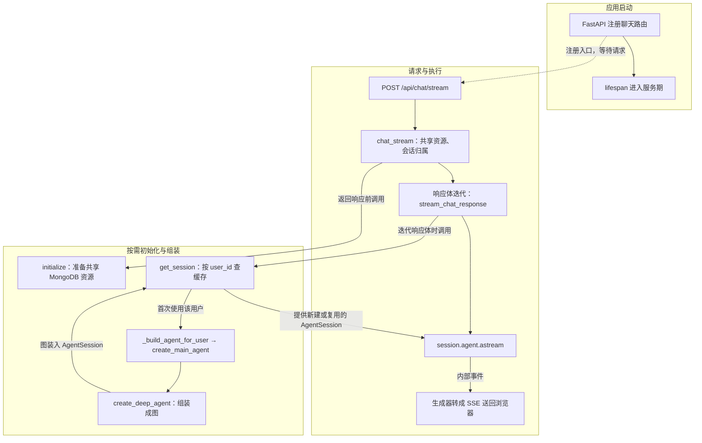
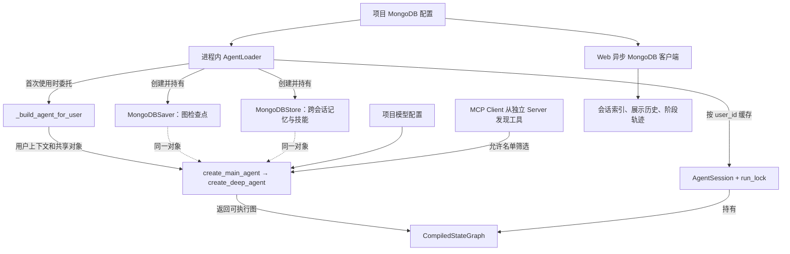
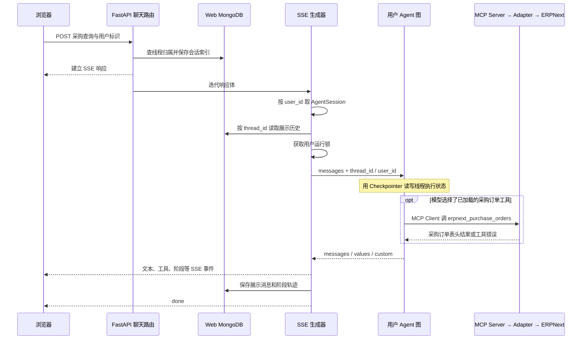

---
aliases:
  - 供应链协同 Agent 核心源码导览
tags:
  - 供应链协同Agent
  - 源码导览
  - 试读版
---

# 供应链协同 Agent｜核心源码中文导览（试读版）

> [!abstract] 页内导航
>
> - **先看全局** · [[#1. 本次阅读目标|阅读目标]] · [[#2. 整体调用关系|整体调用关系]]
> - **对照源码** · [[#3. 关键函数中文说明|函数索引]] · [[#4. 两张关系图|组装与运行图]]
> - **继续 Review** · [[#5. 阅读源码时需要特别关注的设计点|设计点与待验证项]] · [[#6. 本次暂时不需要研究的源码细节|暂缓阅读项]]

## 1. 本次阅读目标

读完能跟踪一条采购问题如何从 FastAPI 请求变成 LangGraph 图的输入，Agent 在何时创建、由谁持有，以及执行事件如何变成浏览器能消费的 SSE（服务器发送事件）。本次细读三个入口文件。MCP（模型上下文协议）、ERP 权限和 MongoDB 只追到与这条链路相接的位置。

本稿依据当前工作区源码和本地安装的锁定版本做静态核对。示例只演示数据形状。

> [!tip]- 在 Obsidian 里旁读源码
> 页内导航可直接跳到对应章节。源码引用保留项目相对路径和行号。如果 Obsidian 无法打开某条源码链接，可在 VS Code 的「快速打开」里输入 `src/api_view/api/chat.py:414` 这样的路径和行号。

## 2. 整体调用关系



> [!important] 应用启动与首次建图
> 模块导入时创建 `agent_loader` 单例。FastAPI 的 `lifespan` 启动段没有预建用户 Agent，也没有启动沙箱维护任务。首次需要共享存储时才初始化 MongoDB 对象。聊天入口调用无参 `initialize()`，用户 Agent 在随后迭代响应体、调用 `get_session()` 时才按需创建。 [web_main.py:48](../../src/api_view/web_main.py#L48) · [路由注册:86](../../src/api_view/web_main.py#L86) · [agent_loader.py:224](../../src/api_view/agent_loader.py#L224)

## 3. 关键函数中文说明

> [!abstract] 函数索引
>
> - **请求与事件** · [[#3.1 接入聊天请求 · chat_stream()|chat_stream()]] · [[#3.2 执行 Agent 并转译事件 · stream_chat_response()|stream_chat_response()]]
> - **共享资源与用户会话** · [[#3.3 准备共享资源 · AgentLoader.initialize()|AgentLoader.initialize()]] · [[#3.4 获取用户级 Agent 会话 · AgentLoader.get_session()|AgentLoader.get_session()]] · [[#3.5 将用户与共享资源交给工厂 · AgentLoader._build_agent_for_user()|AgentLoader._build_agent_for_user()]]
> - **Agent 组装** · [[#3.6 组装采购 Agent · create_main_agent()|create_main_agent()]] · [[#3.7 编译可执行图 · create_deep_agent()|create_deep_agent()]]

### 3.1 接入聊天请求 · chat_stream()

**源码与职责。** 接收 `POST /api/chat/stream`，在交给 SSE 生成器之前准备资源、确定线程归属。 [src/api_view/api/chat.py:414](../../src/api_view/api/chat.py#L414)

**输入。** 请求体由 FastAPI 解析为 `ChatRequest`。下例省略 `thread_id`，由服务端生成。续聊时填入已有的字符串 `thread_id`。省略 `user_id` 或 `username` 时分别使用 `default_user` 和 `用户`。 [ChatRequest:32](../../src/agent/schema.py#L32)

> [!example]- 聊天请求 JSON 示例
>
> ```json
> {
>   "message": "帮我查最近的采购订单",
>   "user_id": "user-001",
>   "username": "采购员"
> }
> ```

**核心处理**

1. 检查模型 API Key 是否有值，缺失时返回 HTTP 503。凭据能否通过模型服务验证要等实际调用。
2. 调用无参 `agent_loader.initialize()`，准备共享持久化对象。
3. 使用传入的 `thread_id` 或生成 UUID。查询 `conversations` 中已登记的归属，已有归属与请求中的 `user_id` 不同时返回 HTTP 403。
4. 在流开始前按 `thread_id` 插入或更新 `conversations`，保存 `user_id`、标题和时间。标题取当前消息前 20 字，超长加 `...`。

**输出与下一跳。** 返回 `StreamingResponse`，媒体类型为 `text/event-stream`，响应头 `X-Thread-Id` 带当前线程 ID。前端 `streamChat()` 发起请求，响应体被迭代时，`stream_chat_response()` 才开始处理传入的消息和标识。 [streamChat:6](../../frontend/src/lib/api.ts#L6) · [StreamingResponse:430](../../src/api_view/api/chat.py#L430)

> [!note]- 设计边界
> 提前保存归属，让中断恢复入口能从 `thread_id` 查回用户。这里比较的是请求体中的 `user_id` 与数据库记录，登录身份是否已由部署层核验见第 5 节。 [chat_resume:484](../../src/api_view/api/chat.py#L484)

### 3.2 执行 Agent 并转译事件 · stream_chat_response()

**源码与职责。** 驱动用户 Agent 图，将内部事件转换成 SSE 文本并保存展示记录。函数定义在第 46 行，上一行的 `@traced_stream` 包装流式追踪。 [src/api_view/api/chat.py:46](../../src/api_view/api/chat.py#L46) · [追踪包装:154](../../src/agent/observability.py#L154)

**输入**

| 名称 | 类型 | 作用 |
| --- | --- | --- |
| `message`、`thread_id` | `str` | 普通消息正文与对话线程键。恢复调用传空正文 |
| `user_id`、`username` | `str` | 获取用户级 Agent，后者在首次创建时用于上下文 |
| `resume_data` | `dict`，默认 `None` | 恢复入口从 `ResumeRequest` 转出的数据。形状如 `{"decisions":[{"type":"approve"}]}` 或 `{"supplement":"补充内容"}`，能否恢复还取决于检查点中的中断 |
| `agent_loader` | `AgentLoader` | 模块共享依赖，提供 Agent、运行配置、Store 和展示消息读写 |

**核心处理**

1. 取 `AgentSession`，生成含 `configurable.thread_id`、`configurable.user_id` 和 `recursion_limit=1000` 的图运行配置。追踪可追加回调。
2. 按线程读取展示历史。普通消息追加一条用户展示记录，传给图的输入为 `{"messages": [{"role": "user", "content": message}]}`。恢复时改传 `Command(resume=resume_data)`。
3. 获取用户级 `run_lock`，绑定当前请求的用户与 Store。代码仍尝试沙箱租约和上下文绑定。恢复请求在锁内再次校验待恢复状态及审批或补充内容。
4. 发出 `thinking` 后调用 `session.agent.astream(..., subgraphs=True)`。按 `(namespace, chunk_type, chunk)` 三元组处理三类流。

   | 图事件 | SSE 转换 |
   | --- | --- |
   | `messages`（消息片段） | 文本变为 `token`。工具调用片段和结果对应 `tool_start`、`tool_args`、`tool_result`、`tool_end`，过滤内部评审器及评审路由的消息 |
   | `values`（图状态） | 阶段和待办生成 `phase`、`todo_update`。从 `__interrupt__` 或兼容字段 `interrupts` 读取中断，字典载荷转为 `interrupt` 事件，随后以 `done` 且 `interrupted: true` 收尾 |
   | `custom`（自定义事件） | 从评审开始和结束事件生成审查阶段的 `phase` 和 `review_result` |

5. 正常或中断时按 `thread_id` 写入 MongoDB 的 `display_messages`（展示历史）与 `harness_traces`（阶段与评审轨迹）。正常结束且用户消息非空时也会更新 `conversations` 标题。进入执行异常分支时尽力保存部分结果，发送 `error`，再发送 `done` 且 `failed: true`。`finally` 复位请求绑定、释放已取得的租约与运行锁。

**输出。** `AsyncGenerator[str, None]`，每次产出一个以空行分隔的 SSE 文本事件。例如图产出文本片段时会生成以下形状，示例正文和 ID 为演示值。 [事件编码:27](../../src/api_view/api/chat.py#L27) · [文本转换:342](../../src/api_view/api/chat.py#L342) · [结束与异常:366](../../src/api_view/api/chat.py#L366)

> [!example]- SSE 响应片段示例
>
> ```text
> event: token
> data: {"content": "查询结果", "source": "main"}
>
> event: done
> data: {"thread_id": "review-thread", "interrupted": false}
>
> ```

**下一跳。** 上游是 `chat_stream()` 或 `chat_resume()`。下游一边驱动 Agent 图，一边转译 UI 事件。浏览器通过 `fetch` 读取响应体，`SSEParser` 按空行拆帧，`useChat` 按事件更新界面。

> [!note]- 设计边界
> 本地源码实际使用三类流，函数头部的“双流”说明省略了 `custom`。正常完成、中断、执行失败都可能发出 `done`，应结合 `interrupted` 和 `failed` 判断结果。 [运行配置:146](../../src/api_view/agent_loader.py#L146) · [三类流:118](../../src/api_view/api/chat.py#L118) · [中断分支:174](../../src/api_view/api/chat.py#L174) · [ResumeRequest:58](../../src/agent/schema.py#L58) · [SSEParser:15](../../frontend/src/lib/sse-parser.ts#L15) · [useChat:168](../../frontend/src/hooks/useChat.ts#L168)

### 3.3 准备共享资源 · AgentLoader.initialize()

**源码与职责。** 为后续 Agent 构建准备共享持久化对象，并提供可选的用户预建入口。 [src/api_view/agent_loader.py:88](../../src/api_view/agent_loader.py#L88)

**输入**

| 名称 | 类型 | 作用 |
| --- | --- | --- |
| `user_id`、`username` | `str \| None`、`str` | 默认 `None`、`"用户"`。只有显式传入非 `None` 的用户 ID 才预建 |
| `self` | `AgentLoader` | 持有 `_store`、`_checkpointer`、客户端与资源初始化锁 |
| MongoDB 配置 | `str` × 2 | `MONGODB_URI`、`MONGODB_DB_NAME` 从项目配置读取 |

**核心处理**

1. 调用 `_ensure_resources()`。已有 Store 时直接复用，否则在共享资源锁内再次检查。
2. 在线程池执行 `_initialize_resources_sync()`。用 PyMongo 客户端构造 `MongoDBSaver`（图检查点），再构造独立持有客户端的 `MongoDBStore`（跨会话存储，集合为 `langgraph_store`）。构造时会建立索引。初始化异常记日志并向上传递。
3. 传入用户 ID 时调用 `get_session()` 预建。聊天入口采用无参调用。

**输出与下一跳。** 返回 `None`。主要产物是挂在 Loader 上的资源，供后续 `get_session()` 构建用户图。聊天、恢复和状态查询入口均会调用该函数。 [资源初始化:52](../../src/api_view/agent_loader.py#L52) · [同步创建:65](../../src/api_view/agent_loader.py#L65) · [Store 索引:95](../../src/api_view/mongodb_store.py#L95)

> [!note]- 设计边界
> 共享资源按进程复用。Web 展示数据走 `get_db()` 的另一套异步客户端。当前 Web 退出代码显式关闭这套异步客户端，Loader 持有的两个同步客户端没有接入该退出路径。 [get_db:20](../../src/api_view/web_config.py#L20) · [退出处理:56](../../src/api_view/web_main.py#L56)

### 3.4 获取用户级 Agent 会话 · AgentLoader.get_session()

**源码与职责。** 以用户为单位缓存可执行图和运行锁，首次取用时创建。 [src/api_view/agent_loader.py:94](../../src/api_view/agent_loader.py#L94)

**输入**

| 名称 | 类型 | 作用 |
| --- | --- | --- |
| `user_id`、`username` | `str`、`str` | `user_id` 是缓存键，`username` 只在首次构建时被采用，默认 `"用户"` |
| `_sessions`、构建锁 | 字典、`asyncio.Lock` | 从 Loader 读取缓存，用用户级构建锁协调同一用户的首次创建 |

**核心处理**

1. 确保共享资源可用，在缓存表锁内查找已存在的用户会话，命中即返回。
2. 未命中则取得该用户的构建锁，再次查缓存，防止同一用户被重复构建。
3. 在线程池调用 `_build_agent_for_user()`。成功后将图与新建的 `run_lock` 装入 `AgentSession`，写入 `_sessions[user_id]`。构建异常会传回调用方。

**输出与下一跳。** 返回 `AgentSession`，包含 `user_id`、`username`、`agent` 和 `run_lock`。流式生成器使用 `session.agent.astream()`，恢复和状态入口用该图读取检查点。 [AgentSession:17](../../src/api_view/agent_loader.py#L17) · [构建与缓存:106](../../src/api_view/agent_loader.py#L106)

> [!note]- 设计边界
> 构建锁保护首次创建，运行锁保护同一用户的图执行。同一个用户的多个 `thread_id` 复用同一个图和运行锁。只有 `default_user` 的图也写入兼容字段 `agent_loader.agent`。

### 3.5 将用户与共享资源交给工厂 · AgentLoader._build_agent_for_user()

**源码与职责。** 把 Loader 管理的资源和当前用户参数转换成主 Agent 工厂的输入。 [src/api_view/agent_loader.py:130](../../src/api_view/agent_loader.py#L130)

**输入**

| 名称 | 类型 | 作用 |
| --- | --- | --- |
| `user_id`、`username` | `str`、`str` | 构造 `ProcurementContext`（采购上下文） |
| `self._checkpointer`、`self._store` | `MongoDBSaver`、`MongoDBStore` | 传递 Loader 已创建的共享对象 |

**核心处理**

1. 在线程池调用中导入项目工厂 `create_main_agent()`。
2. 用用户 ID 和名称构造 `ProcurementContext`，偏好与记忆摘要使用模型默认值。
3. 将上下文、Checkpointer 和 Store 原样交给工厂，返回工厂产物。

**输出与下一跳。** 返回 `CompiledStateGraph`（已编译的可执行图）。上游 `get_session()` 将其装入 `AgentSession`，这里没有运行图。 [上下文模型:23](../../src/agent/schema.py#L23) · [工厂调用:135](../../src/api_view/agent_loader.py#L135)

> [!note]- 设计边界
> 这是 Web 与 Agent 工厂之间的依赖交接点。当前 Web 链路直接构造 `ProcurementContext`，没有调用同文件中的 `precompute_agent_context()`。运行时的记忆摘要由 `WarmMemoryMiddleware` 在模型调用时从 Store 刷新。 [预计算入口:144](../../src/agent/main_agent.py#L144) · [记忆刷新:17](../../src/agent/middlewares/warm_memory.py#L17)

### 3.6 组装采购 Agent · create_main_agent()

**源码与职责。** 把业务规则与模型、工具、存储和子 Agent 组装成项目的采购 Agent。 [src/agent/main_agent.py:188](../../src/agent/main_agent.py#L188)

**输入**

| 名称 | 类型 | 作用 |
| --- | --- | --- |
| `user_context` | `ProcurementContext \| None` | 提供用户 ID 和名称，缺省时创建默认上下文 |
| `checkpointer` | Web 路径为 `MongoDBSaver`，默认 `None` | 供图读写线程执行状态 |
| `store` | Web 路径为 `MongoDBStore`，默认 `None` | 提供用户级长期记忆和技能数据 |
| 模型、MCP 和项目配置 | 工厂与模块配置 | 函数内部读取，决定模型对象、工具来源、评审配置和提示词 |

**核心处理**

1. 通过 `get_llm()` 创建思考模式的主 DeepSeek 模型、非思考模式的评审模型。另按配置构造评审路由模型。
2. 创建 `CompositeBackend`（组合文件后端）。默认 `StateBackend` 将虚拟文件放进图状态。有 Store 时将 `/memories/` 与 `/persisted-skills/` 路由到按用户区分的 Store 空间。当前 `managed_sandbox=False`。
3. 从独立 MCP 服务发现工具并按允许名单筛选，加入按配置启用的记忆工具和技能读取工具。MCP 发现失败并用尽重试时返回空列表，工厂可继续组装。
4. 解析子 Agent 配置，补上 `general-purpose`，为子 Agent 安装只读策略。主图也装入只读策略、待办、记忆、评审和调用上限等中间件。
5. 拼装系统提示词，加入阶段一说明及记忆、技能占位符，调用 `create_deep_agent()` 编译图。其他组装异常会传回 Loader。

**输出与下一跳。** 返回由框架创建的 `CompiledStateGraph`。上游 Web 构建链将它缓存到用户会话，后续 SSE 生成器用它执行。 [后端:221](../../src/agent/main_agent.py#L221) · [工具:246](../../src/agent/main_agent.py#L246) · [中间件:336](../../src/agent/main_agent.py#L336) · [MCP 降级:83](../../src/agent/tools/mcp_client.py#L83)

> [!note]- 设计边界
> 本函数决定“Agent 能接触什么”。实际 ERP 范围和 API 身份在独立 MCP Server 一侧校验。函数开头的组装注释提到沙箱与若干旧工具，当前入口实际采用 `StateBackend` 和阶段一工具策略。 [允许名单:9](../../src/agent/tool_policy.py#L9) · [ERP 工具入口:7](../../src/mcp_server/tools/erpnext_tools.py#L7)

### 3.7 编译可执行图 · create_deep_agent()

**源码与职责。** 框架工厂由项目导入。当前项目的调用点在第 389 行，本地安装的 DeepAgents 0.7.32 实现在依赖目录的第 289 行。 [项目导入:11](../../src/agent/main_agent.py#L11) · [项目调用:389](../../src/agent/main_agent.py#L389) · [.venv/lib/python3.12/site-packages/deepagents/graph.py:289](../../.venv/lib/python3.12/site-packages/deepagents/graph.py#L289)

**输入**

| 参数 | 当前调用传入的类型与作用 |
| --- | --- |
| `model`、`system_prompt` | `ChatDeepSeek`、`str`，主模型和业务提示词 |
| `tools`、`middleware`、`subagents` | 工具列表、中间件实例列表、子 Agent 配置列表，描述可调用能力和执行规则 |
| `backend`、`checkpointer`、`store` | `CompositeBackend`、`MongoDBSaver`、`MongoDBStore`，分别负责文件路由、图检查点、跨会话存储 |
| `skills`、`memory`、`interrupt_on`、`name` | 两个 `None`、空字典、字符串 `"procurement-main-agent"`。技能和记忆用项目中间件管理，当前未配置按工具触发的审批 |

**核心处理**

1. DeepAgents 将主模型、业务提示词、工具和子 Agent 配置整理为图所需的能力与中间件。
2. 调用 LangChain 的 `create_agent()`，继续传入 `checkpointer` 和 `store`。
3. LangChain 编译 LangGraph 状态图。DeepAgents 对产物附加默认运行配置并返回。

**输出与下一跳。** `CompiledStateGraph`，从 `create_main_agent()` 原样返回，最终由 `AgentSession.agent` 持有。真正的执行入口是之后的 `astream()`。 [DeepAgents 委托:1008](../../.venv/lib/python3.12/site-packages/deepagents/graph.py#L1008) · [LangChain 编译:1909](../../.venv/lib/python3.12/site-packages/langchain/agents/factory.py#L1909)

> [!note]- 设计边界
> 项目负责选择和配置依赖，框架负责把这些依赖编译成图。恢复接口和中断事件分支仍在，当前 `INTERRUPT_ON_TOOLS` 为空。 [中断配置:91](../../src/agent/config.py#L91)

## 4. 两张关系图

### 4.1 架构组装图｜依赖从哪里来，由谁持有



### 4.2 运行数据流图｜一条采购查询的请求和返回



上图取正常结束分支。以采购订单为例，MCP Server 的 `erpnext_purchase_orders` 接收 `PurchaseOrderQuery`，把 `Purchase Order` 查询交给 Adapter。工具是否被选中取决于已加载的工具与模型决策。 [采购订单工具:37](../../src/mcp_server/tools/erpnext_tools.py#L37)

## 5. 阅读源码时需要特别关注的设计点

> [!question]+ 1. `user_id` 和 `thread_id` 在哪里生效？
> 源码已证实，`user_id` 选择进程内 Agent 与用户记忆空间，`thread_id` 连接会话记录、展示历史和图检查点。MongoDBSaver 的检查点查询使用线程键和检查点命名空间。Web 归属比较使用请求体字段，ERP Client 则使用服务端配置的 API Key 与 Secret，并向 ERP 校验实际登录用户。
>
> **待验证** · 部署层如何认证 Web 用户，以及恢复和历史入口如何校验访问者身份。 [归属判断:421](../../src/api_view/api/chat.py#L421) · [检查点查询:252](../../.venv/lib/python3.12/site-packages/langgraph/checkpoint/mongodb/saver.py#L252) · [ERP 身份校验:33](../../src/mcp_server/erpnext/client.py#L33)

> [!question]+ 2. 缓存与运行锁保护到哪里？
> 源码已证实，同进程内按用户复用图，图执行与末尾写入在同一用户锁内，展示历史读取在取锁前。
>
> **待验证** · 同线程并发或多个 Web 进程同时处理时，整份历史写回是否会覆盖另一请求的结果。 [历史读取:72](../../src/api_view/api/chat.py#L72) · [加锁:103](../../src/api_view/api/chat.py#L103) · [历史写回:161](../../src/api_view/agent_loader.py#L161)

> [!question]+ 3. 首个 SSE 事件与任务完成分别意味着什么？
> 源码已证实，取用户 Agent、读历史和等待锁都发生在首个 `thinking` 前，部分初始化步骤也在流内 `try` 之前。执行段捕获的异常有 `error` 与失败标记。后端可发出 `review_result`，当前 `useChat` 没有对应的处理分支。
>
> **待验证** · 首次建图失败、代理缓冲或浏览器断开时的实际呈现与落库结果。 [流准备:64](../../src/api_view/api/chat.py#L64) · [异常路径:386](../../src/api_view/api/chat.py#L386) · [前端事件分派:57](../../frontend/src/hooks/useChat.ts#L57)

> [!question]+ 4. 为什么同一请求会留下几类记录？
> 源码已证实，Checkpointer 用于图状态及中断恢复，Store 保存跨会话数据，`display_messages` 服务于页面历史，`harness_traces` 单独保存阶段与评审轨迹。设计意图推测是让界面回放和执行恢复各自使用合适的数据形状。
>
> **待验证** · 用一条真实 ERP 请求对照 Tool 参数、Adapter 范围、ERP API 身份、SSE 和 MongoDB 记录，核实异常时各处分别留下什么。 [图依赖:397](../../src/agent/main_agent.py#L397) · [展示写入:161](../../src/api_view/agent_loader.py#L161) · [轨迹写入:209](../../src/api_view/agent_loader.py#L209)

## 6. 本次暂时不需要研究的源码细节

- FastAPI 如何把异步生成器写到连接，LangGraph 如何在框架内部调度节点。先定位路由、`astream()` 和 SSE 事件转换三个交接点。
- MCP 握手、全部 Tool 的参数表、Adapter 每条过滤规则、ERPNext 凭据的配置方式。下一轮用一条实际采购查询贯穿检查。
- MongoDB 检查点的序列化、记忆归档算法、历史沙箱容器代码、评审中间件内部顺序。当前先区分它们与已组装对象、运行路径的关系。
