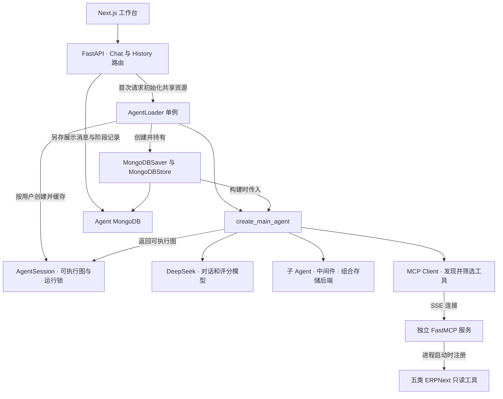
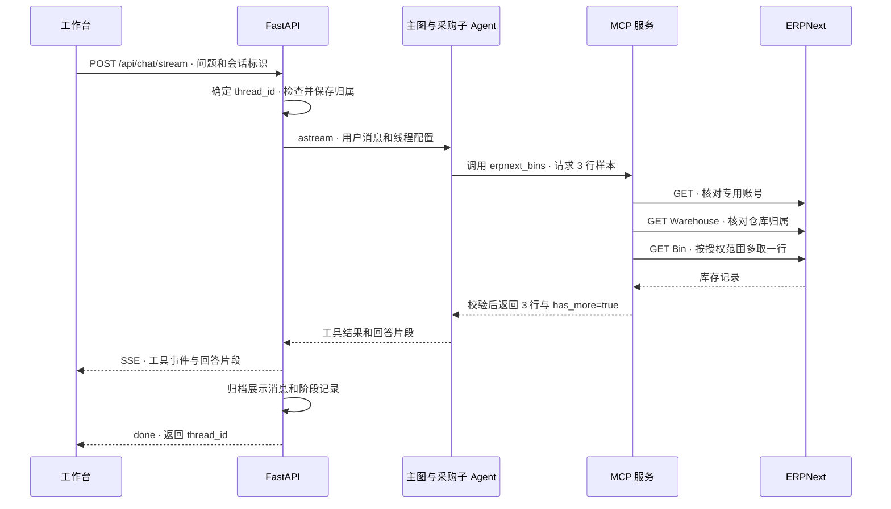

# 供应链协同 Agent · 阶段一技术方案

**2026-11-17 · 基于现有源码整理**

## 1. 上下文

采购人员在工作台用自然语言跟进采购单、核查库存和确认主数据。系统将问题转换成可校验的查询参数，在授权范围内读取 ERPNext，再返回数据、查询范围和执行状态。需求见[阶段一 PRD](PRD-供应链协同Agent.md)及[工作故事](Job-Stories-供应链协同Agent.md)。

## 2. 目标与范围

| 目标 | 设计范围 |
| --- | --- |
| 从对话完成常规采购查询 | 供应商、物料、仓库、库存和采购订单表头。 |
| 可复核、可追问 | 结果保留业务标识、查询范围及分页信息。前端流式展示回答、工具和进度，历史按会话读取。 |
| 控制 ERP 数据范围 | 工具允许名单、服务端公司与仓库限制、ERP 专用账号权限。 |
| 阶段一范围之外 | 订单行明细、采购写入与审批、定量补货、生产登录和逐人 ERP 授权、命令执行。 |

## 3. 设计决策

### 3.1 FastAPI 启动时注册路由，Agent 按用户延迟组装

| 组件 | 创建、持有与生命周期 | 源码 |
| --- | --- | --- |
| FastAPI | 导入 Web 入口时创建 App 并注册路由。Lifespan 退出时关闭 Web Mongo 客户端及追踪。 | [Web 入口](../src/api_view/web_main.py#L48) |
| 共享存储 | 首次聊天请求调用 Loader 的初始化入口，创建检查点和 Store，构建图时传入。 | [初始化](../src/api_view/agent_loader.py#L52)、[依赖传递](../src/api_view/agent_loader.py#L130) |
| 用户 Agent | 流开始时按 `user_id` 查缓存，首次为该用户构建 AgentSession。实例持有图和运行锁，同一进程内同一用户的图执行串行化。 | [会话实例获取](../src/api_view/agent_loader.py#L94)、[执行入口](../src/api_view/api/chat.py#L111) |
| ERP 查询服务 | 独立进程启动时注册工具。主 Agent 组装时发现工具。每次工具调用新建并关闭 ERP HTTP Client。 | [服务入口](../src/mcp_server/server_main.py)、[发现工具](../src/agent/main_agent.py#L246)、[工具执行](../src/mcp_server/tools/erpnext_tools.py#L7) |

### 3.2 用框架组装执行图，用项目代码定义采购行为

DeepAgents 提供 Agent 组装和子 Agent 能力，LangGraph 执行图、发出流事件并持久化检查点。项目配置主模型、采购子角色、工具允许名单，以及待办、技能按需读取和结果审查等中间件。主 Agent 可以直接查，也可经 `task` 委派。审查检查结果质量，授权仍由查询服务和 ERP 专用账号执行。[Agent 组装](../src/agent/main_agent.py#L188)、[创建执行图](../src/agent/main_agent.py#L388)

| 存储 | 用途 |
| --- | --- |
| 图检查点 | 按 `thread_id` 保存图状态，支持同一会话续跑。默认 `StateBackend` 的虚拟文件随图状态保存。 |
| 跨会话 Store | 组合后端把 `/memories/` 和 `/persisted-skills/` 路由给 StoreBackend。 |
| 工作台展示记录 | Web 层另存会话归属、标题、展示消息和阶段记录。 |

当前使用虚拟文件后端，FastAPI 启动时不创建 Docker 沙箱。应用会持久化上述记录，ERP 业务数据保持只读。[组合后端](../src/agent/main_agent.py#L221)、[消息归档](../src/api_view/agent_loader.py#L161)

### 3.3 把 ERP 范围约束放在查询服务

主 Agent 和子 Agent 通过允许名单及运行时中间件限制工具。MCP 的 Adapter（适配层）追加服务端范围并校验返回数据，HTTP Client 核对令牌对应的账号，仅通过 GET 查询。所有聊天会话共享固定的 ERP 专用账号。[工具策略](../src/agent/tool_policy.py)、[适配层](../src/mcp_server/erpnext/adapter.py#L13)、[HTTP Client](../src/mcp_server/erpnext/client.py#L20)

| 查询对象 | 读取范围 |
| --- | --- |
| 供应商与物料 | 共享主数据，遵循 ERP 账号权限。 |
| 仓库与库存 | 限定公司和仓库允许名单。查库存前先核对仓库所属公司。 |
| 采购订单 | 按公司和 ERP 账号权限读表头。业务状态 `status` 与单据状态 `docstatus` 分开，表头查询无订单行仓库过滤。 |

## 4. 实际查询数据流

选用 **2026-10-30 本机服饰演示库验收的 Bin 库存抽样**。采购子 Agent 调用一次 `erpnext_bins`，取 3 行样本，返回 3 行且 `has_more=true`。其中 `DEMO-HD-G-L` 在「演示-杭州总仓 - Mundane」的现存量为 **97.0**，历史验收曾与独立 ERP GET 样本核对。图中的内部步骤根据当前源码还原，本次未重跑服务。[验收记录](PHASE1_ACCEPTANCE.md) · [实测样本](evidence/closeout-erp-workbench.json)

| 交接点 | 输入与输出 | 源码 |
| --- | --- | --- |
| 前端 → FastAPI | POST JSON 包含 `message`、可选 `thread_id` 和客户端身份字段。新会话由后端生成线程 ID。 | [前端请求](../frontend/src/lib/api.ts#L6)、[ChatRequest](../src/agent/schema.py#L32)、[路由](../src/api_view/api/chat.py#L414) |
| FastAPI → Agent | 问题变成 `{"messages":[{"role":"user","content":"…"}]}`。线程标识经配置传入。图输出消息、状态及自定义事件。 | [流生成器](../src/api_view/api/chat.py#L46)、[astream](../src/api_view/api/chat.py#L118) |
| Agent → MCP → ERP | 参数放在 `query` 对象内，库存支持 `item_code`、`warehouse`、`limit`、`offset`。后端取 `limit + 1` 条判断下一页，返回 `data/limit/offset/has_more/scope`。 | [Bin 工具](../src/mcp_server/tools/erpnext_tools.py#L32)、[输入模型](../src/mcp_server/erpnext/models.py#L32)、[查询过滤与分页](../src/mcp_server/erpnext/adapter.py#L13) |
| Agent → FastAPI → 前端 | FastAPI 将流转换为 SSE（服务端事件流）。前端通过 Fetch 读取并处理 `tool_result`、`token`、`todo_update`、`done` 等事件。工具结果的展示摘要最多 2,000 字符，回复由模型根据工具结果生成。 | [SSE 转换](../src/api_view/api/chat.py#L332)、[前端事件处理](../frontend/src/hooks/useChat.ts#L60) |

## 5. 风险与取舍

| 取舍 | 影响 |
| --- | --- |
| 分页和库存口径 | `has_more=true` 时仍需查后续页才能做全量统计。现存量 `actual_qty` 与包含计划因素的预计量 `projected_qty` 应分列。 |
| 本机身份 | 请求提供的 `user_id` 用于会话划分。多人发布前需接入可信登录、会话资源授权及岗位数据权限。 |
| 失败状态 | MCP 工具层传递脱敏错误。流内异常会尝试保存部分内容，再输出 `error` 和带 `failed=true` 的 `done`。一次工具失败可能由 Agent 处理，整体执行结果需看后续状态。 |
| 委派和审查成本 | 多步调查可委派和审查，也会增加模型调用和上下文成本。历史验收记录过一次完整任务超时，后续重跑成功。稳定性、全量分页及目标企业试点仍待验证。 |

[流内异常处理](../src/api_view/api/chat.py#L386) · [阶段一验收记录](PHASE1_ACCEPTANCE.md) · [采购查询验收用例](采购查询功能-验收用例.md)
